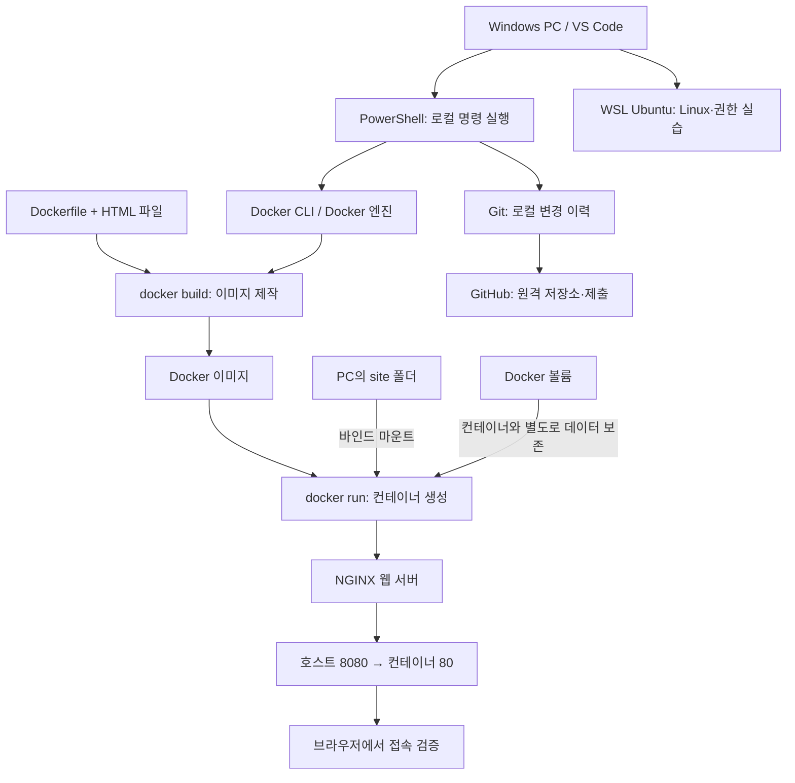

# E1-1 | 내 컴퓨터에 개발자의 작업실 만들기

> **코디세이 올인원 과정 · 개발 입문 / 개발 워크스테이션 구축**  
> **진행 상태:** 재시작 · 실습 재검증 중  
> **제출 저장소:** [modoofighting/E1-1](https://github.com/modoofighting/E1-1)

## 핵심목표

이 과제는 **명령어를 실행하는 개발 환경을 이해하고, Docker로 웹 서버를 구축한 뒤, 실행 결과를 검증하여 GitHub에 공유**하는 실습이다. 단순히 명령어가 실행되었다는 사실보다 **왜 사용하는지, 무엇이 바뀌었는지, 어떤 증거로 확인했는지**를 설명하는 것을 목표로 한다.

**작업 원칙:** 개념 이해 → 명령 실행 → 실제 출력 확인 → 성공·실패 판단 → 로그·증거 기록 → README 갱신.

**이 문서의 명령어 읽는 방법**

- 명령어 바로 위의 `#`로 시작하는 문장은 **설명 주석**이다. PowerShell과 Bash에서 실행되지 않으므로, 명령의 의미를 이해하는 데 활용한다.
- 명령어는 **어디에서 실행하는지(Windows PowerShell / WSL Ubuntu Bash / Docker 컨테이너 내부)** 확인한 후 입력한다.
- `--version`, `-a`, `-p` 등은 명령어에 추가 기능을 지정하는 **옵션**이다. 옵션의 뜻을 모르면 먼저 설명을 읽는다.
- 코드의 **실행 예시와 실제 검증 결과는 구별한다.** 아래 예시를 실행했다고 가정하여 로그·성공 여부를 기록하지 않는다.
- 삭제·덮어쓰기·컨테이너 종료·Git 업로드 명령은 실습 대상을 확인한 후 사용한다.

> **재시작 안내:** Docker와 이전 실습 자료를 정리한 이후 다시 수행하고 있다. 아래 명령어·파일 내용은 **실습 지침과 작성안**이며, 실제 실행·검증을 완료했다는 뜻이 아니다. 이전에 기록된 WSL 점검 결과는 과거 이력으로만 표시한다. 결과가 확인될 때마다 상태와 증빙 링크를 갱신한다.

### 과제 수행 현황

| 구분 | 현재 상태 | 대표 증빙 |
|---|---|---|
| GitHub 저장소 및 README | 기존 저장소 확인, README 개정 중 | [저장소](https://github.com/modoofighting/E1-1) |
| WSL·Ubuntu 점검 | 재확인 필요 | [이전 WSL 점검 캡처](evidence/01-environment/01-wsl-precheck.png) |
| Linux 명령·경로·권한 | 재시작 이후 실습 확인 필요 | `logs/02-terminal.txt`, `logs/03-permissions.txt` (예정) |
| Docker 설치·엔진 동작 | 삭제 이후 재설치/재확인 필요 | `logs/04-docker-basic.txt` (예정) |
| 이미지·Ubuntu 컨테이너 운영 | 재수행 예정 | `logs/05-container.txt` (예정) |
| Dockerfile 및 NGINX 웹 서버 | 재수행 예정 | `Dockerfile`, `site/index.html` (예정) |
| 포트 매핑·브라우저 접속 | 재검증 예정 | `images/03-web-8080.png` (예정) |
| 바인드 마운트·볼륨 영속성 | 재검증 예정 | `logs/07-mount-volume.txt` (예정) |
| Git·GitHub·VS Code 연동 | 로컬 연결 상태 재확인 필요 | `logs/08-git.txt` (예정) |
| 트러블슈팅·최종 제출 | 진행 중 | 11~12장 |

## 01. 프로젝트 목표와 산출물

### 1.1 학습 목표

- 절대 경로와 상대 경로를 실제 폴더 이동 사례로 구별한다.
- Linux 파일 권한 `r/w/x`와 `755`, `644`의 의미를 설명한다.
- Docker 이미지, 컨테이너, Dockerfile의 관계를 구별하고 커스텀 이미지를 만든다.
- 호스트 포트와 컨테이너 포트가 왜 연결되어야 하는지 설명한다.
- 바인드 마운트와 Docker 볼륨을 비교하고 데이터 유지 여부를 검증한다.
- Git(로컬 이력 관리)과 GitHub(원격 보관·협업)를 구별한다.

### 1.2 제출 산출물

1. 이 README: **전체 구조·핵심 개념·대표 명령·검증 결과·증거 위치**
2. 실제 작성한 `Dockerfile`과 웹페이지 소스
3. 터미널·Docker·Git 명령의 **실제 출력 로그**
4. 포트 접속, 파일 권한, GitHub 연동을 확인하는 화면 증빙
5. 실제 발생한 문제 **2건 이상**의 원인 확인 및 해결/대안 기록

README에는 핵심 과정과 판단 근거를 적고, 긴 출력 전체는 별도 로그 파일로 분리한다. **존재하지 않는 파일을 증빙 링크로 제출하지 않는다.**

## 02. 전체 시스템 구조와 핵심 개념

### 2.1 구조도



### 2.2 기술별 역할

| 개념 | 역할 | 이번 과제에서 확인할 것 |
|---|---|---|
| 터미널 | 명령 입력·결과 확인 창 | 명령이 어느 환경에서 실행되는지 |
| PowerShell | Windows의 명령 실행 셸 | PC에서 Git·Docker 호출 |
| WSL Ubuntu | Windows에서 사용하는 Linux 환경 | Linux 경로·파일·권한 실습 |
| Docker 엔진 | 이미지·컨테이너 관리 | Docker 서비스가 실제 응답하는지 |
| Dockerfile | 이미지를 만드는 작업 지침 | NGINX에 내 웹페이지 포함 |
| Docker 이미지 | 컨테이너의 실행 원본 | `docker build`, `docker images` |
| 컨테이너 | 이미지로 생성한 격리된 실행 단위 | `run`, `ps`, `stop`, `exec` |
| NGINX | HTTP로 웹페이지 제공 | 로컬 브라우저 접속 |
| 바인드 마운트 | PC 폴더를 컨테이너에 연결 | PC에서 수정한 HTML 반영 |
| Docker 볼륨 | Docker가 관리하는 데이터 저장 공간 | 컨테이너 삭제 후 데이터 유지 |
| Git | 로컬 파일의 변경 이력 | `status`, `commit` |
| GitHub | 원격 저장소·공유 | `remote`, `push` |

**주의:** WSL의 Ubuntu와 Docker의 Ubuntu 컨테이너는 서로 다른 환경이다. 명령어를 실행하기 전 **현재 터미널이 PowerShell인지, WSL Bash인지, 컨테이너 내부인지** 먼저 확인한다.

### 2.3 전체 작업 순서

`환경·기록 위치 확인 → WSL/Linux 실습 → Docker 점검 → 이미지·컨테이너 → Dockerfile → 웹 접속 → 마운트·볼륨 → GitHub·README 최종 검수`

## 03. 개발 환경 확인 및 재구축

### 3.1 현재 상태부터 확인

**실행 위치: Windows PowerShell**  
**목적:** 삭제한 도구와 남아 있는 도구를 구분해 불필요한 재설치를 피한다.

```powershell
# ① 현재 작업 중인 폴더의 위치를 확인합니다.
# Get = 가져오기, Location = 위치 → 지금 내가 어디에서 작업하는지 알려줍니다.
Get-Location

# ② 현재 Windows에서 PowerShell의 버전을 확인합니다.
# PS = PowerShell, Version = 버전 → 버전 정보만 표시합니다.
$PSVersionTable.PSVersion

# ③ Git·Docker·WSL 실행 명령을 Windows가 찾을 수 있는지 점검합니다.
# Get-Command = 명령 위치 조회, -ErrorAction SilentlyContinue = 없는 항목의 오류 메시지는 표시하지 않음.
# | (파이프) = 앞 명령의 결과를 뒤로 전달, Select-Object Name,Source = 이름·파일 위치만 보여줌.
# 주의: 명령이 보인다고 설치·서버 동작이 모두 정상인 것은 아닙니다.
Get-Command git,docker,wsl -ErrorAction SilentlyContinue | Select-Object Name,Source

# ④ WSL(Windows Subsystem for Linux)의 기본 설정과 상태를 확인합니다.
# status = 상태. Ubuntu가 설치되었다는 뜻은 아니므로 아래 목록도 확인합니다.
wsl --status

# ⑤ 설치된 Linux 배포판 목록과 작동 상태를 확인합니다.
# -l = list(목록), -v = verbose(자세한 정보: 상태·WSL 버전 포함).
wsl -l -v

# ⑥ WSL 프로그램과 커널의 버전을 확인합니다.
# --version = 버전 정보 보기. 위의 '-v'와 확인 대상이 다릅니다.
wsl --version

# ⑦ 기존 E1-1 로컬 작업 폴더가 남아 있는지 확인합니다.
# Test = 검사, Path = 경로. True = 존재, False = 존재하지 않음.
# 경로가 없다고 바로 새 폴더를 만들지 말고 GitHub 원격 자료부터 확인합니다.
Test-Path "G:\내 드라이브\codyssey\E1-1-github"

# ⑧ Git 프로그램의 버전을 확인합니다.
# --version은 '설치된 프로그램의 버전을 보여 줘'라는 뜻입니다.
git --version

# ⑨ Docker 명령줄 프로그램(CLI)의 버전을 확인합니다.
# 이 결과만으로 Docker 엔진이 정상 작동한다고 판단하면 안 됩니다.
docker --version
```

위 명령은 상태를 조회하는 명령이다. **실제 출력은** `logs/01-environment.txt`에 기록한다(파일 생성 후 README에 연결).

**이전 기록:** 기존 README에는 WSL 2.7.11.0, 커널 6.18.33.2-2, `docker-desktop` 배포판 확인 기록이 있다. [이전 화면 증빙](evidence/01-environment/01-wsl-precheck.png). 이는 **Docker 삭제 이전 기록**이므로 현재 설치 상태를 입증하지 않는다.

### 3.2 환경 구성 원칙

- WSL이 남아 있다면 전체 재설치보다 Ubuntu 배포판 유무부터 확인한다.
- Ubuntu가 없다면 필요한 Linux 실습 환경을 별도로 준비한다. `docker-desktop`은 일반 Ubuntu 학습용 배포판과 동일하지 않다.
- Docker Desktop 설치 여부를 확인하고, 필요할 때에만 공식 배포판으로 재설치한다.
- **`docker --version`만으로는 엔진 정상 작동이 입증되지 않는다.** `docker info`의 서버 정보를 함께 확인한다.
- 기존 로컬 폴더가 남아 있다면 새 저장소를 중복 생성하지 않는다. `git status -sb`, `git remote -v`로 연결 상태를 확인한다.

### 3.3 최종 실행 환경 기록

| 항목 | 재검증 후 입력 |
|---|---|
| Windows 버전 | 확인 중 |
| PowerShell 버전 | 확인 중 |
| WSL 및 Ubuntu 배포판 | 확인 중 |
| Docker Client / Server 버전 | 확인 중 |
| Git 버전 | 확인 중 |
| VS Code 버전 | 확인 중 |
| 로컬 작업 경로 | 확인 중 |

**완료 기준:** 설치된 도구와 실행 위치를 구분하고, Docker 서버 응답 여부까지 확인한다.

## 04. 터미널·경로·파일 권한 실습

### 4.1 파일과 디렉터리 조작

**실행 위치: WSL Ubuntu의 Bash**. 아래 예시는 다른 실습 파일을 건드리지 않도록 `~/e1-1-cli-practice`에 실습용 폴더를 만든다.

```bash
# ① 내 홈 폴더(~) 아래에 실습 전용 폴더를 만듭니다.
# mkdir = make directory(폴더 만들기), -p = 상위 경로까지 필요 시 생성하며 기존 폴더도 허용.
mkdir -p ~/e1-1-cli-practice

# ② 생성한 폴더로 이동합니다. cd = change directory(폴더 이동).
cd ~/e1-1-cli-practice

# ③ 현재 위치를 확인합니다. pwd = print working directory(현재 작업 경로 출력).
pwd

# ④ 파일·숨김 파일·권한을 확인합니다.
# ls = list, -l = 상세 정보, -a = 숨김 파일(이름이 점으로 시작하는 파일)도 표시.
ls -la

# ⑤ 내용이 없는 파일을 만듭니다. touch = 파일이 없으면 새로 만들고 있으면 수정 시각 변경.
touch empty.txt

# ⑥ 문장을 파일에 기록합니다.
# echo = 문자열 출력, > = 출력 내용을 파일에 저장(기존 내용이 있다면 덮어씀).
echo "Hello CLI" > note.txt

# ⑦ 저장된 파일을 읽습니다. cat = 파일 내용을 터미널에 보여 줌.
cat note.txt

# ⑧ 원본을 복사합니다. cp = copy, 뒤의 두 값은 '원본 → 복사본 이름'.
cp note.txt copy.txt

# ⑨ 복사본 이름을 변경합니다. mv = move(이동·이름 변경).
mv copy.txt renamed.txt

# ⑩ 변경된 파일 목록을 확인합니다.
ls -la

# ⑪ 오직 실습에서 만든 renamed.txt 파일만 삭제합니다.
# rm = remove(삭제). 휴지통을 거치지 않을 수 있으므로 파일명을 먼저 확인합니다.
rm renamed.txt

# ⑫ 삭제 후 파일 목록을 재확인합니다.
ls -la
```

| 명령 | 의미·확인할 변화 |
|---|---|
| `pwd` | 현재 위치의 전체 경로 |
| `ls -la` | 숨김 항목과 권한을 포함한 목록 |
| `cd`, `mkdir` | 폴더 이동·생성 |
| `touch`, `echo`, `cat` | 빈 파일 생성·내용 작성·확인 |
| `cp`, `mv`, `rm` | 복사·이름 변경·삭제 |

**경로 이해:** `/home/사용자/e1-1-cli-practice`처럼 루트(`/`)부터 시작점을 명시하면 **절대 경로**, `note.txt`처럼 현재 위치를 기준으로 표현하면 **상대 경로**다. `~`는 로그인 사용자의 홈 폴더를 뜻한다. `.`은 현재 폴더, `..`은 상위 폴더다.

**증빙 예정:** `logs/02-terminal.txt` — 명령어와 실제 출력, `pwd`로 확인한 위치.

### 4.2 파일·폴더 권한 비교

**실행 위치: WSL Ubuntu Bash**

```bash
# ① 앞서 만든 전용 실습 폴더로 이동합니다.
cd ~/e1-1-cli-practice

# ② 실습용 파일 1개와 폴더 1개를 준비합니다.
touch sample.txt
mkdir -p perm-dir

# ③ 비교할 기준 권한을 설정합니다.
# chmod = change mode(권한 변경).
# 644 = 소유자 읽기·쓰기 / 그룹 읽기 / 기타 사용자 읽기.
chmod 644 sample.txt
# 755 = 소유자 읽기·쓰기·실행 / 그룹과 기타 사용자 읽기·실행.
chmod 755 perm-dir

# ④ 변경 전 권한을 확인해 로그로 남깁니다.
# ls -l = 파일 상세 정보, ls -ld = 폴더 자체의 권한 표시.
ls -l sample.txt
ls -ld perm-dir

# ⑤ 권한을 더 제한하는 실험입니다.
# 600 = 소유자만 읽기·쓰기, 700 = 소유자만 읽기·쓰기·실행(폴더 진입 포함).
chmod 600 sample.txt
chmod 700 perm-dir

# ⑥ 변경 후 권한을 확인해 위 출력과 비교합니다.
ls -l sample.txt
ls -ld perm-dir

# ⑦ 실습이 끝나면 처음 권한으로 복원합니다.
chmod 644 sample.txt
chmod 755 perm-dir
```

`r`은 읽기(4), `w`는 쓰기(2), `x`는 실행·디렉터리 진입(1) 권한이다. `644`는 소유자 읽기·쓰기(6), 그룹과 기타 사용자 읽기(4·4)이며, `755`는 소유자 읽기·쓰기·실행(7), 그룹과 기타 사용자 읽기·실행(5·5)을 뜻한다.

**완료 기준:** 파일 1개와 디렉터리 1개에서 **권한 변경 전·후 출력**을 비교하고, 권한 숫자의 의미를 설명한다.

**증빙 예정:** `logs/03-permissions.txt`.

## 05. Docker 설치 및 엔진 점검

**실행 위치: Windows PowerShell**

```powershell
# ① docker 프로그램(Client/CLI)의 버전을 확인합니다.
# --version = 버전 정보만 출력. Docker 엔진(Server) 작동은 별도로 확인해야 합니다.
docker --version

# ② Docker 엔진에 실제로 연결하여 서버 정보를 확인합니다.
# info = 환경·엔진·이미지·컨테이너 관련 종합 정보.
docker info

# ③ 현재 PC의 Docker 이미지 목록을 확인합니다.
# image = 실행 원본, ls = list(목록).
docker image ls

# ④ 실행 중·중지된 컨테이너 전체를 확인합니다.
# ps = 프로세스/컨테이너 상태 목록, -a = all(전체).
docker ps -a
```

- `docker --version`: CLI 프로그램의 버전을 확인한다.
- `docker info`: Docker 엔진(Server)에 연결되는지 확인한다.
- `docker image ls`: 로컬 이미지 목록을 확인한다.
- `docker ps -a`: 실행 중·종료된 컨테이너 목록을 확인한다.

**완료 기준:** `docker info`에서 서버 정보가 조회된다. 오류가 나면 Docker Desktop 실행 상태와 WSL 연동을 점검하고 실제 오류 메시지를 보존한다. 특히 `docker --version`은 **클라이언트 설치 여부**, `docker info`는 **서버 통신 상태**에 가까운 확인이라는 차이를 설명할 수 있어야 한다.

**증빙 예정:** `logs/04-docker-basic.txt`.

## 06. Docker 이미지와 컨테이너 운영

### 6.1 hello-world 실행

**실행 위치: Windows PowerShell**

```powershell
# ① 간단한 시험용 hello-world 이미지를 컨테이너로 실행합니다.
# run = 이미지로부터 컨테이너 생성 후 실행. 이미지가 없으면 내려받을 수 있습니다.
docker run hello-world

# ② hello-world 이미지가 로컬에 생겼는지 확인합니다.
docker image ls

# ③ 종료된 hello-world 컨테이너도 포함해 전체 목록을 확인합니다.
docker ps -a
```

`hello-world`는 컨테이너 실행 경로가 정상인지 확인하는 최소 실험이다. **완료 기준:** 이미지가 확보되고 성공 안내 문구가 실제로 출력된다. 문구를 임의로 작성하지 않고 원본 결과를 기록한다.

### 6.2 Ubuntu 컨테이너에 진입

```powershell
# ① Ubuntu 24.04 이미지를 내려받습니다.
# pull = 이미지 다운로드, ubuntu:24.04 = 이미지 이름:버전 태그.
docker pull ubuntu:24.04

# ② 이미지를 실행 가능한 컨테이너로 만듭니다.
# run = 새 컨테이너 생성·실행, -d = 백그라운드, -i = 입력 유지, -t = 가상 터미널 사용.
# --name = 컨테이너 이름 지정, bash = 컨테이너가 시작할 명령.
docker run -dit --name e11-ubuntu ubuntu:24.04 bash

# ③ 컨테이너가 생성되고 실행 중인지 확인합니다.
docker ps -a

# ④ 실행 중인 e11-ubuntu 컨테이너 안에 별도의 Bash를 엽니다.
# exec = 기존 컨테이너 안에서 새 명령 실행, -it = 대화형 입력·터미널.
docker exec -it e11-ubuntu bash
```

마지막 명령 뒤에는 **Ubuntu 컨테이너 내부 Bash**에서 다음 명령을 실행한다.

```bash
# 여기부터는 Windows가 아니라 'Ubuntu 컨테이너 내부'의 Bash입니다.
# ① 컨테이너 내부의 현재 경로를 확인합니다.
pwd

# ② 컨테이너 내부의 파일 목록을 봅니다. -l = 상세, -a = 숨김 포함.
ls -la

# ③ 컨테이너에 설치된 Ubuntu 운영체제 정보를 읽습니다.
# /etc/os-release는 Linux 배포판 정보를 기록한 파일입니다.
cat /etc/os-release

# ④ 컨테이너 내부에서 문장을 출력해 명령 실행을 확인합니다.
echo "Hello Ubuntu"

# ⑤ 'exec로 추가한 Bash'에서 빠져나옵니다.
# 이 경우 보통 컨테이너의 최초 Bash 프로세스는 계속 실행됩니다.
exit
```

PowerShell로 돌아온 뒤에는 컨테이너 상태를 비교한다.

```powershell
# ① 컨테이너에서 빠져나온 뒤 실행 상태를 확인합니다.
docker ps -a

# ② 컨테이너의 주 프로세스가 남긴 표준 출력·오류 로그를 조회합니다.
# logs = 출력 기록. exec에서 화면에 본 출력이 항상 여기에 포함되는 것은 아닙니다.
docker logs e11-ubuntu

# ③ 자원 사용량을 1회만 확인합니다.
# stats = CPU·메모리 등 자원 통계, --no-stream = 계속 갱신하지 않고 한 번 표시.
docker stats --no-stream

# ④ 실습 컨테이너를 중지합니다. stop = 실행 중지(컨테이너는 남음).
docker stop e11-ubuntu

# ⑤ 중지한 컨테이너를 다시 시작합니다. start는 새 컨테이너를 만들지 않습니다.
docker start e11-ubuntu
```

**`exec`와 `attach` 차이:** `exec`는 실행 중 컨테이너 안에 **별도의 프로세스**를 시작한다. `attach`는 컨테이너의 기존 표준 입출력에 연결한다. `attach` 상태에서 메인 프로세스를 종료하면 컨테이너도 종료될 수 있으므로, **분리 키 `Ctrl+P`, `Ctrl+Q`를 사용한 유지 실험**과 `exit`를 사용한 종료 실험은 상태를 확인하며 구분해서 수행한다.

실습용 이름 `e11-ubuntu`가 이미 존재하면 다시 `docker run --name`을 실행하기 전에 `docker ps -a`에서 확인한다. 기존 컨테이너를 자동으로 삭제하지 않는다.

**완료 기준:** 이미지와 컨테이너의 차이, 컨테이너 진입·재시작·중지, `exec`/`attach`의 동작을 설명한다.

**증빙 예정:** `logs/05-container.txt`.

**추가 실습 — `attach`로 연결해 보기:** 위 `start`로 컨테이너가 실행 중인 상태에서, PowerShell에서 `docker attach e11-ubuntu`를 실행하면 기존 Bash 프로세스의 입출력에 연결된다. **`exit`를 입력하면 주 Bash가 종료되어 컨테이너도 중지될 수 있다.** 종료 없이 빠져나올 때는 `Ctrl+P`를 누른 뒤 `Ctrl+Q`를 누르고 `docker ps -a`로 상태를 비교한다. (이 단계도 본인이 실제로 수행한 후 로그에 남긴다.)

## 07. Dockerfile로 커스텀 웹 서버 이미지 만들기

### 7.1 베이스 이미지와 커스텀 포인트

웹 서버 구축 방식은 **NGINX 베이스 이미지에 직접 만든 정적 HTML을 포함하는 방식**을 사용한다. `nginx:alpine`은 웹 서버가 포함된 기반 이미지이며, `COPY`로 내 웹페이지를 넣는 것이 커스텀 요소다.

**작성할 프로젝트 파일**

```text
E1-1-github/
├── README.md
├── Dockerfile                 # 작성 예정
├── site/
│   └── index.html            # 작성 예정
├── logs/                     # 실습별 실제 명령/출력
├── images/                   # 화면 증거
└── evidence/                 # 이전 점검 자료 보존
```

**Dockerfile 작성 예시** (실제 작성 후 파일과 일치하는지 대조):

```dockerfile
# FROM = 기반 이미지 선택. nginx:alpine은 NGINX가 포함된 가벼운 Linux 기반 이미지입니다.
FROM nginx:alpine

# COPY = 내 PC의 site/ 폴더 내용을 이미지 내부의 NGINX 웹문서 경로에 복사합니다.
# 왼쪽은 빌드 대상(현재 프로젝트)의 파일, 오른쪽은 컨테이너 안의 경로입니다.
COPY site/ /usr/share/nginx/html/
```

**웹페이지 최소 예시:** `site/index.html`의 `<h1>`에 과제 이름을 작성한다. **Dockerfile은 실제로 직접 작성한 파일을 제출**하며, 예제만 README에 적는 것으로 완료 처리하지 않는다.

### 7.2 빌드와 실행

**실행 위치: Windows PowerShell, Dockerfile이 있는 프로젝트 루트**

```powershell
# 반드시 Dockerfile과 site 폴더가 있는 프로젝트 루트에서 실행합니다.
# ① Dockerfile을 이용해 내 웹 서버 이미지를 제작합니다.
# build = 이미지 만들기, -t = 이름·태그 지정, . = 현재 폴더를 빌드 컨텍스트로 사용.
docker build -t e11-web:1.0 .

# ② 방금 만든 e11-web:1.0 이미지가 있는지 확인합니다.
docker image ls

# ③ NGINX 웹 서버를 컨테이너로 실행합니다.
# -d = 백그라운드, --name = 컨테이너 이름, -p = 포트 연결.
# 8080:80 = PC의 8080 포트로 들어온 요청을 컨테이너의 80 포트로 보냅니다.
docker run -d --name e11-web-8080 -p 8080:80 e11-web:1.0

# ④ 실행 중인 컨테이너와 포트 매핑을 확인합니다.
docker ps

# ⑤ NGINX 웹 서버가 남긴 로그를 확인합니다.
docker logs e11-web-8080
```

- `build`: Dockerfile을 바탕으로 이미지를 만든다.
- `-t`: 이미지 이름과 태그(`e11-web:1.0`)를 붙인다.
- `.`: 현재 폴더를 빌드 문맥으로 사용한다.
- `-p 8080:80`: **내 PC의 8080 포트 → 컨테이너의 80 포트**로 연결한다.

**완료 기준:** 실제 이미지가 목록에 보이고, 웹 서버 컨테이너가 실행 중이다.

**증빙 예정:** `logs/06-web-server.txt`, `Dockerfile`, `site/index.html`.

## 08. NGINX 웹 접속과 포트 매핑 검증

**실행 위치: Windows PowerShell 및 브라우저**

```powershell
# ① 웹 서버의 HTTP 응답 헤더를 확인합니다.
# curl.exe = 웹 요청 프로그램, -I = 본문 없이 응답 헤더만 요청.
# localhost = 내 PC, :8080 = 앞서 연결한 호스트 포트.
curl.exe -I http://localhost:8080/

# ② 실제 HTML 응답 본문을 확인합니다. -I가 없으면 본문도 요청합니다.
curl.exe http://localhost:8080/

# ③ 컨테이너가 실행 중이고 '8080->80' 연결이 보이는지 확인합니다.
docker ps
```

브라우저에서 `http://localhost:8080`에 접속하여 직접 만든 HTML이 나타나는지 확인한다. `curl.exe`로 HTTP 응답을 확인하고, **주소창의 `localhost:8080`과 실제 웹페이지가 함께 보이도록** 캡처한다.

**완료 기준:** HTTP 응답과 브라우저 표시가 같은 웹페이지를 가리킨다. `HTTP/1.1 200 OK` 같은 응답 코드와 실제 HTML 표시를 함께 확인하되 **성공 코드는 실행 결과에서 확인한 경우에만 기록**한다. 포트가 이미 사용 중이라면 다른 호스트 포트를 지정하고 변경 이유를 기록한다.

**증빙 예정:** `logs/06-web-server.txt`, `images/03-web-8080.png`.

## 09. 바인드 마운트와 Docker 볼륨

### 9.1 바인드 마운트: PC 파일 변경이 즉시 반영되는가?

**실행 위치: Windows PowerShell, 프로젝트 루트. `site` 폴더 생성 후 실행한다.**

```powershell
# ① PC의 site 폴더를 컨테이너의 NGINX 문서 폴더에 직접 연결합니다.
# Resolve-Path .\site = 현재 폴더 안의 site 경로를 절대 경로로 변환.
# --mount type=bind = PC 폴더 연결, source = PC 경로, target = 컨테이너 내부 경로.
# readonly = 컨테이너 쪽에서 파일을 읽기 전용으로 취급.
# -p 8081:80 = PC 8081 포트 → 컨테이너 80 포트 연결.
docker run -d --name e11-web-bind -p 8081:80 --mount "type=bind,source=$((Resolve-Path .\site).Path),target=/usr/share/nginx/html,readonly" nginx:alpine

# ② 수정하기 전 웹페이지 내용을 확인하고 로그에 남깁니다.
curl.exe http://localhost:8081/
```

VS Code에서 **PC의** `site/index.html` 제목을 수정·저장한 뒤 다시 조회한다.

```powershell
# ③ VS Code에서 site/index.html을 수정·저장한 후 다시 조회합니다.
# 이미지를 새로 빌드하지 않고 내용이 바뀌면 바인드 마운트 반영이 확인됩니다.
curl.exe http://localhost:8081/
```

바인드 마운트는 호스트 폴더를 컨테이너 내부 경로에 직접 연결한다. **완료 기준:** 이미지를 다시 빌드하지 않아도 수정된 HTML 내용이 보인다. 수정 전·후 출력과 화면을 모두 기록한다.

### 9.2 Docker 볼륨: 컨테이너 삭제 뒤에도 남는가?

**실행 위치: Windows PowerShell. 아래의 `e11-vol-a`는 이 실습 전용으로 만든 컨테이너만 사용한다.**

```powershell
# ① 데이터를 별도로 보존할 Docker 볼륨을 만듭니다.
# volume = Docker 관리 저장 공간, create = 생성.
docker volume create e11-demo-data

# ② Ubuntu 컨테이너를 만들고 볼륨을 /data 경로에 연결합니다.
# --mount source=... = 볼륨 이름, target=/data = 컨테이너 안 연결 위치.
# sleep infinity = 컨테이너가 실험 중 계속 실행되게 유지하는 명령.
docker run -d --name e11-vol-a --mount source=e11-demo-data,target=/data ubuntu:24.04 sleep infinity

# ③ 컨테이너 안의 /data/check.txt에 preserved를 쓰고 바로 읽어 확인합니다.
# sh -c = 작은 셸 명령 실행, > = 파일 저장, && = 앞 명령이 성공했을 때 다음 명령 실행.
docker exec e11-vol-a sh -c 'echo preserved > /data/check.txt && cat /data/check.txt'
```

`preserved`가 기록된 것을 확인한 후 **이 실습용 컨테이너만 삭제**하고 새 컨테이너를 연결한다.

```powershell
# ④ '이 실습에서 만든 e11-vol-a' 컨테이너만 삭제합니다.
# rm = remove(컨테이너 삭제), -f = 실행 중이어도 강제 종료 후 삭제.
# 주의: 컨테이너 이름을 반드시 확인하고 실행합니다. 볼륨 자체는 삭제하지 않습니다.
docker rm -f e11-vol-a

# ⑤ 새로운 컨테이너를 만들되 이전과 같은 볼륨을 다시 연결합니다.
docker run -d --name e11-vol-b --mount source=e11-demo-data,target=/data ubuntu:24.04 sleep infinity

# ⑥ 새 컨테이너에서도 기존 파일을 읽을 수 있는지 확인합니다.
# preserved가 실제 출력되면 컨테이너를 교체해도 볼륨 데이터가 남는다는 증거입니다.
docker exec e11-vol-b cat /data/check.txt
```

**완료 기준:** 새 컨테이너에서도 `preserved`가 확인된다. **컨테이너 삭제와 볼륨 삭제는 다르며, `docker volume rm`은 이 검증 단계에서 사용하지 않는다.**

| 구분 | 바인드 마운트 | Docker 볼륨 |
|---|---|---|
| 데이터 관리 | PC의 지정 폴더 | Docker가 관리하는 저장 공간 |
| 검증 대상 | PC 파일 수정이 컨테이너에 반영 | 컨테이너를 교체해도 데이터 보존 |
| 주요 용도 | 개발 중 소스·설정 공유 | 독립적인 영속 데이터 관리 |

**증빙 예정:** `logs/07-mount-volume.txt`, 필요시 수정 전후 화면 캡처.

## 10. Git·GitHub·VS Code 연동

### 10.1 로컬 저장소의 현재 상태 확인

**실행 위치: Windows PowerShell, 기존 `E1-1-github` 폴더**

```powershell
# ① Git 저장소의 변경 상태와 현재 브랜치를 간단하게 표시합니다.
# status = 상태, -s = short(짧게), -b = branch(브랜치 정보).
git status -sb

# ② 연결된 원격 GitHub 저장소 주소를 확인합니다.
# remote = 원격 저장소, -v = verbose(가져오기/보내기 주소 자세히 표시).
git remote -v

# ③ 현재 선택된 브랜치 이름을 보여 줍니다.
# branch = 작업 이력의 갈래, --show-current = 현재 브랜치만 표시.
git branch --show-current

# ④ 가장 최근 커밋 1건을 한 줄로 확인합니다.
# log = 이력, -1 = 최신 1건, --oneline = 한 줄 요약.
git log -1 --oneline

# ⑤ Git 프로그램 자체의 버전을 확인합니다.
git --version
```

Git은 **내 PC의 변경 이력**을 관리하고, GitHub는 **해당 이력을 원격 저장소에 보관·공유**한다. `commit`은 로컬에 이력으로 기록하는 작업이고, `push`는 이를 원격에 보내는 작업이다.

**중요:** 기존 Git 저장소가 있으므로 `git init` 또는 `git clone`을 무조건 다시 실행하지 않는다. `user.name`, `user.email`은 필요한 경우 확인하되 공개 로그에는 개인 이메일·토큰을 노출하지 않는다.

### 10.2 문서 갱신 및 업로드 절차

1. README·실제 코드·로그·이미지 중 제출할 파일만 확인한다.
2. `git status`와 `git diff`로 변경 사항을 검토한다.
3. 변경 사항 검토 후 명시적으로 승인한 범위만 `git add`한다.
4. `git commit`으로 이력을 남기고, `git push`로 GitHub에 반영한다.
5. GitHub 웹페이지에서 README와 상대 경로 링크가 열리는지 확인한다.

**참고 명령:** 아래는 **추후 변경을 승인한 뒤** 실행할 예시이며, 현재 실행 기록이 아니다.

```powershell
# ※ 아래는 향후 변경 내용을 확인하고 '업로드를 승인한 뒤' 사용하는 절차입니다.
# ① 로컬 파일 중 수정·추가·삭제된 사항을 확인합니다.
git status

# ② README.md에서 바뀐 줄을 비교합니다.
# diff = 차이 확인, -- 뒤는 옵션과 파일 경로를 구분합니다.
git diff -- README.md

# ③ 검토가 끝난 README.md만 이번 커밋 대상으로 지정합니다.
# add = Git 기록 대기 영역(stage)에 올리기. 아직 GitHub 업로드는 아닙니다.
git add README.md

# ④ 승인한 변경 사항을 로컬 Git 이력으로 저장합니다.
# commit = 변경 이력 확정, -m = 커밋 설명 문구.
git commit -m "docs: update E1-1 evidence-backed README"

# ⑤ 로컬 main 브랜치의 새 커밋을 원격 GitHub(origin)에 전송합니다.
# push = 원격으로 올리기. 실행 전에 대상 저장소와 브랜치를 확인합니다.
git push origin main
```

**완료 기준:** VS Code 소스 제어에서 브랜치·변경 이력을 확인하고, GitHub 원격 저장소에서 동일한 파일을 확인한다.

**증빙 예정:** `logs/08-git.txt`, `images/04-vscode-github.png`.

## 11. 트러블슈팅: 문제·원인·재검증

과제 요구사항에 따라 **실제로 발생한 사례 2건 이상**을 기록한다. 현재 Docker 삭제 전후 상태만으로 문제 해결 사례를 임의로 확정하지 않는다.

### 사례 1 — 실제 발생 시 기록

| 항목 | 기록 내용 |
|---|---|
| 발생 단계 | 미기록 |
| 실행 명령 | 미기록 |
| 실제 오류 출력 | 미기록 |
| 원인 가설 | 미기록 |
| 확인한 명령·근거 | 미기록 |
| 조치 또는 대안 | 미기록 |
| 재검증 결과 | 미기록 |
| 원본 로그 | 미생성 |

### 사례 2 — 실제 발생 시 기록

| 항목 | 기록 내용 |
|---|---|
| 발생 단계 | 미기록 |
| 실행 명령 | 미기록 |
| 실제 오류 출력 | 미기록 |
| 원인 가설 | 미기록 |
| 확인한 명령·근거 | 미기록 |
| 조치 또는 대안 | 미기록 |
| 재검증 결과 | 미기록 |
| 원본 로그 | 미생성 |

**기록 원칙:** 원인 **가설**과 실제 확인된 **원인**을 구분한다. 오류를 해결하지 못했더라도 확인 과정과 대안을 투명하게 기록한다.

## 12. 최종 검증 및 제출

### 12.1 필수 점검표

> 체크 표시는 재시작 이후 **실제 증거가 확인된 항목만** 완료로 변경한다.

- [ ] 실제 개발 환경 및 WSL·Ubuntu 상태 확인
- [ ] 터미널의 경로·파일 기본 조작 수행 및 출력 보존
- [ ] 파일 1개·폴더 1개 권한 변경 전후 비교
- [ ] Docker Client와 Server의 정상 동작 확인
- [ ] `hello-world` 실행 성공
- [ ] Ubuntu 컨테이너 내부 실습, `exec`/`attach` 차이 확인
- [ ] 이미지·컨테이너 목록/로그/자원 확인
- [ ] Dockerfile 직접 작성 및 커스텀 이미지 빌드
- [ ] NGINX 컨테이너 웹 접속, 포트와 주소창 증빙
- [ ] 바인드 마운트 수정 전후 반영 비교
- [ ] 볼륨의 컨테이너 삭제 전후 데이터 유지 검증
- [ ] Git 설정·VS Code·GitHub 원격 연결 증빙
- [ ] 실제 오류 해결 또는 대응 사례 2건 이상 기록
- [ ] README의 주요 명령·실제 검증 결과·증빙 연결
- [ ] 비밀번호·토큰·개인정보 미노출 확인
- [ ] 처음 보는 사람이 안내에 따라 재현 가능한지 확인

### 12.2 결과별 증빙 관리 규칙

명령어의 긴 출력은 아래 파일에 단계별로 보존한다. **생성 예정 경로는 아직 증빙 링크가 아니며**, 파일이 실제 생성되면 README에 `[로그 보기](logs/파일명)` 형태의 상대 링크를 추가한다.

| 단계 | 원본 로그 파일(생성 예정) | 핵심 검증 |
|---|---|---|
| 환경 | `logs/01-environment.txt` | 설치 상태와 버전 |
| 터미널 | `logs/02-terminal.txt` | 명령·파일 변화 |
| 권한 | `logs/03-permissions.txt` | 변경 전·후 권한 |
| Docker 기본 | `logs/04-docker-basic.txt` | CLI·Server 응답 |
| 컨테이너 | `logs/05-container.txt` | 실행·중지·진입·운영 |
| 웹 서버 | `logs/06-web-server.txt` | 빌드·HTTP·브라우저 |
| 저장소 검증 | `logs/07-mount-volume.txt` | 수정 반영·데이터 유지 |
| Git | `logs/08-git.txt` | 로컬·원격 연동 |

**기록 형식:** 실습 날짜(한국시간) / 실행 위치 / 목표 / 실제 명령 / 실제 출력 / 검증 판단 / 오류·보완 사항. 명령과 결과를 하나의 기록에서 함께 확인할 수 있도록 작성한다. 브라우저 증거는 **주소창과 표시 화면**을 동시에 포함한다.

### 12.3 다른 PC에서 재현하는 방법

1. Git과 Docker 실행 환경을 준비한다. Linux 명령 실습에는 WSL Ubuntu 등 적절한 Bash 환경을 별도로 준비한다.
2. 제출 저장소를 새로운 작업 폴더로 복제한다: `git clone https://github.com/modoofighting/E1-1.git`.
3. `README.md`가 있는 폴더로 이동한다.
4. 03~06장의 환경·터미널·Docker 실습을 확인한다.
5. `Dockerfile`과 `site/index.html`이 존재하는지 확인한 뒤 07~09장의 빌드·접속·저장소 검증을 수행한다.
6. 이미 사용 중인 컨테이너 이름이나 포트가 있다면 충돌 여부를 확인하고 이름·포트를 일관되게 변경한다.
7. 원본과 다른 경로·운영체제에서는 OS에 맞는 명령어를 사용하며, 실제 검증 결과를 별도로 기록한다.

### 12.4 최종 제출 상태

- **제출 URL:** https://github.com/modoofighting/E1-1
- **상태:** README 초안 작성 / 재시작 이후 실행·검증 및 증빙 연결 미완료
- **최종 확인일:** 실제 검증 완료 시 기록

---

### 명령어 해석 빠른 참고

| 기호·옵션 | 뜻 | 대표 사용 상황 |
|---|---|---|
| `#` | 주석: 실행되지 않는 설명 | 명령어 뜻을 함께 기록 |
| `--version` | 프로그램 버전 확인 | `git --version`, `docker --version` |
| `-l`, `-a`, `-v` | 같은 문자라도 **명령마다 뜻이 달라질 수 있음** | `wsl -l`은 목록, `ls -l`은 상세, `git remote -v`는 상세 |
| `.` / `..` / `~` | 현재 폴더 / 상위 폴더 / 홈 폴더 | Bash의 파일 경로 이동 |
| `>` | 출력을 파일에 저장(기존 내용 덮어쓰기) | `echo ... > note.txt` |
| `|` | 앞 명령의 결과를 다음 명령으로 전달 | PowerShell의 `Select-Object` |
| `-d`, `-it`, `--name` | Docker에서 백그라운드 / 대화형 / 컨테이너 이름 | `docker run` |
| `-p 8080:80` | 내 PC 8080번을 컨테이너 80번에 연결 | 웹 서버 접속 |
| `-t e11-web:1.0` | Docker 이미지에 이름·버전 태그 부여 | `docker build` |
| `-m` | 커밋 메시지를 바로 지정 | `git commit -m` |

> **주의:** 옵션은 각각의 명령어에 속하므로 글자만 외우지 않는다. 예를 들어 `ls -a`의 `-a`와 `docker ps -a`의 `-a`는 모두 전체 항목 표시를 뜻하지만, 표시 대상은 파일과 컨테이너로 다르다.

### 참고 자료

- 코디세이 E1-1 과제 지시문 — 사용자가 제공한 미션 원문을 기준으로 요구사항 반영 (별도 공개 파일 링크 없음)
- [참고 사례: AerideS/Codyssey E1-1 문서](https://github.com/AerideS/Codyssey/blob/main/e1-1/e1-1.md) — **문서·로그 구성 방식 참고**, 실행 결과는 본인 실습으로 별도 검증
- [Docker Desktop Windows 설치 안내](https://docs.docker.com/desktop/setup/install/windows-install/)
- [Microsoft WSL 기본 명령](https://learn.microsoft.com/ko-kr/windows/wsl/basic-commands)
