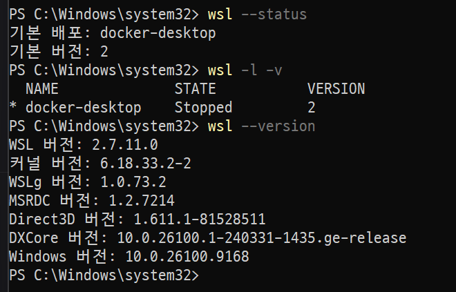

# E1-1 | 개발 워크스테이션 구축

**코디세이 올인원 과정 — 개발 입문**

과제명: 내 컴퓨터에 개발자용 '작업실' 꾸미기

수행 환경: [실제 환경 입력]

수행 상태: 진행 중

최종 제출: GitHub Repository URL

---

## 01. 프로젝트 개요

### 1.1 과제 목적

Linux CLI, Docker, Git·GitHub를 활용해 재현 가능한 개발 환경을 구축하고, 컨테이너 기반 웹 서버의 실행·연결·데이터 보존을 검증한다.

### 1.2 학습 목표

- [ ] 절대 경로와 상대 경로의 차이 이해
- [ ] 파일 접근 권한(r/w/x, 755, 644) 이해
- [ ] Docker 이미지와 컨테이너의 관계 이해
- [ ] Dockerfile 기반 커스텀 이미지 제작
- [ ] 웹 서버의 포트 매핑 이해
- [ ] 바인드 마운트와 볼륨 영속성 이해
- [ ] Git과 GitHub의 역할 구분
- [ ] 실행 결과를 검증하고 문서화

### 1.3 최종 산출물

| 산출물 | 내용 | 확인 위치 |
|---|---|---|
| 개발 환경 | 터미널·Docker·Git 설정 | 03~05장 |
| Docker 실습 | 이미지·컨테이너 실행 | 06장 |
| 웹 서버 | 커스텀 NGINX 이미지 | 07~08장 |
| 저장소 검증 | 바인드 마운트·볼륨 | 09장 |
| 협업 환경 | Git·GitHub·VS Code | 10장 |
| 문제 해결 | 트러블슈팅 2건 이상 | 11장 |
| 검증 결과 | 실행 로그·스크린샷 | 각 장 및 12장 |

---

## 02. 전체 시스템 구조

### 2.1 개발 워크스테이션 구성도

[전체 시스템 구조도 삽입]

### 2.2 기술별 역할

| 기술 | 주요 역할 | 상호 관계 |
|---|---|---|
| Terminal | 명령어 입력·출력 | 셸 실행 환경 |
| PowerShell/Bash | 명령 해석·실행 | Docker·Git 호출 |
| Docker | 컨테이너 실행·관리 | 이미지 기반 실행 |
| Docker Image | 실행 파일·설정 묶음 | 컨테이너 생성에 사용 |
| Dockerfile | 이미지 제작 지침 | Build 수행 |
| NGINX | 웹페이지 제공 | 컨테이너 내부 실행 |
| Bind Mount | PC 파일 연결 | 호스트와 컨테이너 연결 |
| Docker Volume | 데이터 보존 | 컨테이너와 별도 저장 |
| Git | 버전 관리 | 작업 이력 기록 |
| GitHub | 원격 저장소·협업 | 과제 제출 |

### 2.3 전체 실행 흐름

1. 개발 환경 확인
2. Docker 이미지 확보
3. Dockerfile 작성 및 이미지 빌드
4. 컨테이너 실행
5. NGINX 웹 서버 작동
6. 포트 매핑을 통한 접속
7. 마운트·볼륨 검증
8. GitHub 기록 및 제출

---

## 03. 개발 환경 구축 및 확인

### 3.1 기존 WSL 환경 사전 점검

**작업 목적**

Windows에 이미 설치된 WSL 환경을 확인하고, 기존 Docker Desktop 설정을 보존하면서 Linux 실습 환경을 구성하기 위한 사전 점검을 수행하였다.

**실행 환경**

- 운영체제: Windows 11 (빌드 26100.9168)
- 터미널: Windows PowerShell
- WSL 버전: 2.7.11.0
- WSL 커널: 6.18.33.2-2

**실행 명령어**

```powershell
wsl --status
wsl -l -v
wsl --version
```

**주요 실행 결과**

```text
기본 배포: docker-desktop
기본 버전: 2

NAME              STATE      VERSION
docker-desktop    Stopped    2

WSL 버전: 2.7.11.0
커널 버전: 6.18.33.2-2
```

**결과 분석**

1. WSL2가 이미 설치되어 있음을 확인하였다.
2. Docker Desktop 관련 WSL 배포판이 등록되어 있다.
3. docker-desktop 배포판은 확인 당시 Stopped 상태였다.
4. Ubuntu 배포판은 설치 목록에 나타나지 않았다.
5. 따라서 기존 WSL 환경을 재설치하지 않고 Ubuntu 배포판을 추가하는 방향으로 진행한다.

**실행 증거**



**검증 결과:** WSL2 설치 상태 확인 완료 / Ubuntu 설치 및 Docker 엔진 동작 확인은 후속 작업


| 항목 | 실제 사용 환경 |
|---|---|
| 운영체제(OS) | [입력] |
| 터미널 | [입력] |
| 셸(Shell) | [입력] |
| VS Code | [버전 입력] |
| Docker 실행 환경 | [입력] |
| Docker 버전 | [실행 결과] |
| Git 버전 | [실행 결과] |
| GitHub 저장소 | [URL] |

### 3.2 환경 확인 과정

**사용한 명령어:** [실제 입력 명령]

**실행 결과:** [실제 출력]

**검증 결과:** [확인 내용]

**증거:** [스크린샷 삽입]

### 3.3 환경 선택 이유 및 주의사항

[운영체제와 Docker 실행 방식의 선택 이유]

[다른 PC에서 재현할 때 필요한 조건]

---

## 04. 터미널 및 Linux 기초 실습

### 4.1 파일·폴더 조작

| 실습 | 사용 명령 | 실행 결과 | 검증 |
|---|---|---|---|
| 현재 위치 확인 | pwd | [결과] | ☐ |
| 숨김 파일 포함 목록 | ls -la | [결과] | ☐ |
| 디렉터리 이동 | cd | [결과] | ☐ |
| 디렉터리 생성 | mkdir | [결과] | ☐ |
| 파일 복사 | cp | [결과] | ☐ |
| 이동·이름 변경 | mv | [결과] | ☐ |
| 파일 삭제 | rm | [결과] | ☐ |
| 파일 내용 확인 | cat | [결과] | ☐ |
| 빈 파일 생성 | touch | [결과] | ☐ |

※ 명령어는 Linux Bash 기준 예시이며 실제 실습 환경에 맞게 기록한다.

**실제 수행 명령 및 출력:** [기록]

**실행 증거:** [스크린샷 삽입]

### 4.2 절대 경로와 상대 경로

- 절대 경로 정의:
- 상대 경로 정의:
- 실제 실습 예시:
- 차이점:

### 4.3 파일 권한 실습

| 대상 | 변경 전 | 변경 후 | 결과 |
|---|---|---|---|
| 파일 1개 | [권한] | [권한] | [확인] |
| 디렉터리 1개 | [권한] | [권한] | [확인] |

**사용한 명령:** [기록]

**변경 전후 증거:** [스크린샷 삽입]

**r/w/x와 755·644 의미:** [설명]

---

## 05. Docker 환경 구축 및 점검

### 5.1 Docker 실행 환경 준비

- 선택한 Docker 실행 환경:
- 선택 이유:
- 설치 또는 기존 설치 상태:
- 환경 제약 및 해결 방법:

### 5.2 Docker 버전 확인

**확인 명령:** docker --version

**실제 출력:** [기록]

**증거:** [캡처 삽입]

### 5.3 Docker 엔진 작동 확인

**확인 명령:** docker info

**실제 출력:** [기록]

**정상 작동 판단 근거:** [설명]

**증거:** [캡처 삽입]

---

## 06. Docker 이미지 및 컨테이너 실습

### 6.1 Docker 이미지 이해

- Docker 이미지 정의:
- Docker 이미지가 필요한 이유:
- 이미지와 컨테이너의 차이:
- 이미지와 Dockerfile의 관계:
- 이미지가 저장·관리되는 방식:

### 6.2 기존 이미지 확보

| 항목 | 내용 |
|---|---|
| 이미지 확보처 | [예: Docker Hub] |
| 이미지 이름·태그 | [기록] |
| 선택 이유 | [설명] |
| 다운로드 명령 | [기록] |
| 다운로드 결과 | [기록] |

**이미지 다운로드 및 목록 확인 증거:** [캡처 삽입]

### 6.3 hello-world 실행

- 실행 명령:
- 출력 결과:
- 성공 판단 근거:

**증거:** [캡처 삽입]

### 6.4 Ubuntu 컨테이너 실습

- 컨테이너 실행 및 내부 진입:
- 내부 명령 수행:
- 출력 결과:
- 컨테이너 종료 및 재진입:
- attach와 exec 차이:

**증거:** [명령과 출력 캡처 삽입]

### 6.5 Docker 운영 명령 검증

| 명령 | 검증 내용 | 결과 |
|---|---|---|
| docker images | 이미지 목록 | [기록] |
| docker ps | 실행 중 컨테이너 | [기록] |
| docker ps -a | 전체 컨테이너 | [기록] |
| docker logs | 실행 로그 | [기록] |
| docker stats | 자원 사용 상태 | [기록] |

**실행 증거:** [필요한 캡처 삽입]

---

## 07. Dockerfile 기반 커스텀 이미지 제작

### 7.1 제작 방식 및 선택 이유

- 선택 방식: [A 또는 B]
- 베이스 이미지:
- 이미지 출처:
- 선택 이유:

### 7.2 프로젝트 파일 구성

[실제 디렉터리 구조 삽입]

### 7.3 Dockerfile 작성

[직접 작성한 Dockerfile 내용 삽입]

### 7.4 커스텀 포인트

| 변경 사항 | 적용 목적 |
|---|---|
| [변경 1] | [이유] |
| [변경 2] | [이유] |

### 7.5 이미지 빌드 및 확인

- 빌드 명령:
- 빌드 결과:
- 생성 이미지 이름·태그:
- 이미지 목록 확인 결과:

**증거:** [실제 빌드 로그 및 이미지 목록 캡처]

### 7.6 컨테이너 실행

- 실행 명령:
- 실행 결과:
- 실행 상태 확인:
- 정상 작동 판단 근거:

**증거:** [캡처 삽입]

---

## 08. NGINX 웹 서버와 포트 매핑

### 8.1 웹 서버 구성

- 웹 서버: [실제 사용]
- 웹페이지 내용:
- 컨테이너 내부 포트:
- 호스트 포트:

### 8.2 포트 매핑

| 항목 | 설정 |
|---|---|
| 호스트 포트 | [실제 값] |
| 컨테이너 포트 | [실제 값] |
| 접속 주소 | [실제 URL] |
| 설정 목적 | 브라우저 접속 연결 |

**실행 명령 및 출력:** [기록]

### 8.3 브라우저 접속 검증

- 접속 주소:
- 화면 출력 결과:
- 정상 접속 여부:

**접속 화면:** [주소창과 실제 웹페이지가 함께 보이는 스크린샷 삽입]

### 8.4 추가 접속 검증

[다른 포트 접속 실험을 수행한 경우 기록]

---

## 09. 바인드 마운트 및 데이터 영속성

### 9.1 바인드 마운트 실습

**목표:** 호스트 파일 변경이 컨테이너에 반영되는지 검증

| 항목 | 내용 |
|---|---|
| 호스트 경로 | [기록] |
| 컨테이너 경로 | [기록] |
| 연결 명령 | [기록] |
| 변경 파일 | [기록] |

**변경 전:** [파일 내용 및 화면 캡처]

**변경 후:** [파일 내용 및 화면 캡처]

**검증 결과:** [변경 반영 여부]

### 9.2 Docker 볼륨 실습

**목표:** 컨테이너 삭제 후에도 데이터가 유지되는지 검증

- 볼륨 생성:
- 볼륨 연결:
- 테스트 데이터 저장:
- 기존 데이터 확인:
- 컨테이너 삭제:
- 신규 컨테이너 생성:
- 동일 볼륨 재연결:
- 데이터 유지 확인:

| 검증 시점 | 데이터 존재 여부 | 결과 |
|---|---|---|
| 컨테이너 삭제 전 | [확인] | [기록] |
| 컨테이너 삭제 후 재연결 | [확인] | [기록] |

**삭제 전 증거:** [캡처]

**삭제 후 증거:** [캡처]

### 9.3 두 저장 방식의 차이

[바인드 마운트와 Docker 볼륨의 저장 위치·관리 방식·사용 목적 비교]

---

## 10. Git·GitHub·VS Code 연동

### 10.1 Git 기본 설정

- 사용자 이름:
- 이메일: [공개 범위 확인 후 기록]
- 기본 브랜치:
- Git 버전:
- git config --list 확인 결과:

**설정 확인 증거:** [민감정보 제거 후 캡처]

### 10.2 GitHub 저장소 연결

- 저장소 URL:
- 로컬 저장소 위치:
- VS Code 연동 방법:
- 로그인 및 연동 상태:

**연동 증거:** [캡처 삽입]

### 10.3 변경 이력 및 업로드

- 변경 파일:
- Commit 기록:
- Push 결과:
- GitHub에서 확인한 내용:

**증거:** [실제 GitHub 저장소 화면 캡처]

---

## 11. 트러블슈팅

### 11.1 문제 해결 사례 1

- 발생 상황:
- 실제 오류 메시지:
- 원인 가설:
- 확인 방법:
- 확인 결과:
- 실제 원인:
- 해결 방법 또는 대안:
- 재검증 결과:

**증거:** [오류 발생 및 해결 화면]

### 11.2 문제 해결 사례 2

- 발생 상황:
- 실제 오류 메시지:
- 원인 가설:
- 확인 방법:
- 확인 결과:
- 실제 원인:
- 해결 방법 또는 대안:
- 재검증 결과:

**증거:** [오류 발생 및 해결 화면]

※ 실제로 경험하고 검증한 문제만 기록한다.

---

## 12. 최종 검증 및 제출

### 12.1 필수 요구사항 최종 점검

- [ ] GitHub Repository 확인
- [ ] README 기본 정보 및 실행 환경 기록
- [ ] 터미널 명령과 출력 결과 기록
- [ ] 파일·디렉터리 권한 실습 완료
- [ ] Docker 설치·엔진 점검 완료
- [ ] 이미지 다운로드·컨테이너 실행 완료
- [ ] 운영 명령 및 로그 기록 완료
- [ ] Dockerfile 직접 작성
- [ ] 커스텀 이미지 빌드 성공
- [ ] 웹 서버 접속 성공
- [ ] 바인드 마운트 변경 반영 검증
- [ ] Docker 볼륨 영속성 검증
- [ ] Git·GitHub·VS Code 연동
- [ ] 트러블슈팅 2건 이상
- [ ] README에서 모든 증거 확인 가능
- [ ] 민감정보 노출 없음

### 12.2 재현 방법

[처음 실행하는 사람이 동일 환경을 구축하기 위한 전제조건 및 실행 순서]

### 12.3 최종 확인 결과

- 전체 성공 여부:
- 확인이 필요한 항목:
- 환경상 제한 사항:
- 미완료 항목:

### 12.4 최종 제출

**GitHub Repository:** [URL]

**제출 상태:** [완료 여부]

---

## 참고: 주요 학습 개념

- Terminal / CLI / Shell
- Linux 파일 권한
- Docker Image / Container / Dockerfile
- NGINX / Port Mapping
- Bind Mount / Docker Volume
- Git / GitHub / Repository

기술 개념의 상세한 학습 기록은 별도의 Obsidian 노트에서 관리한다.