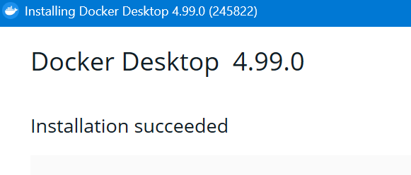
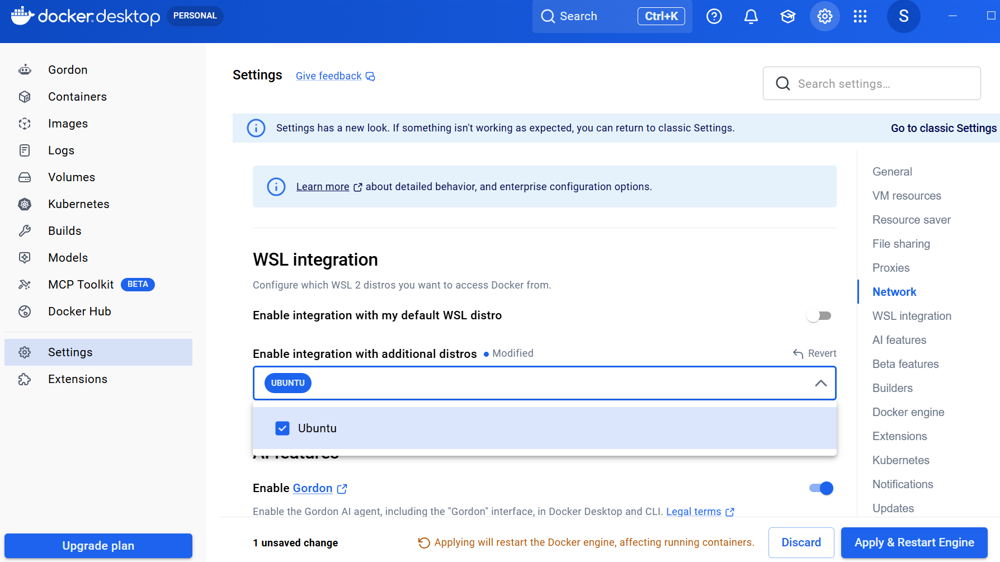
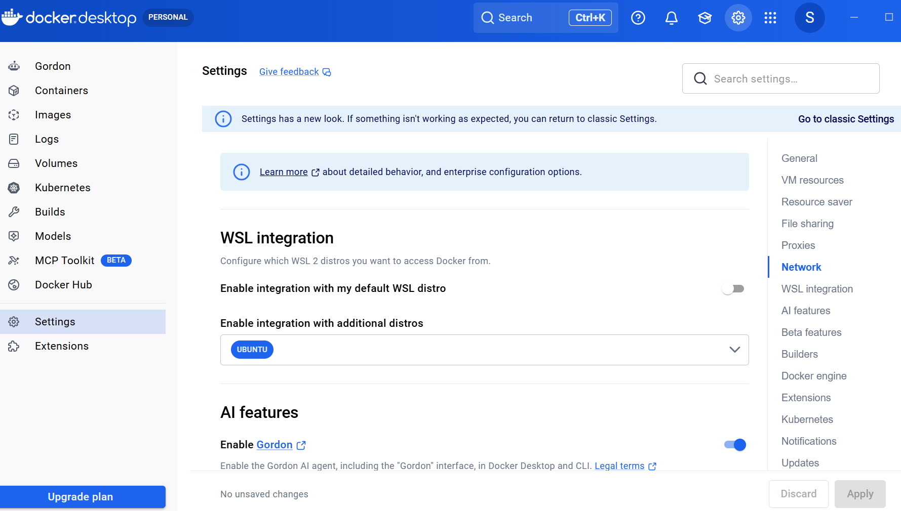
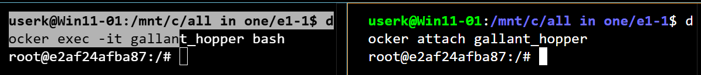
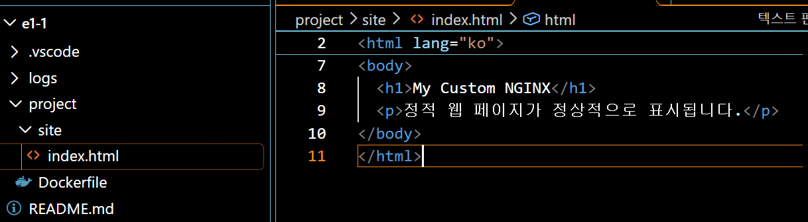
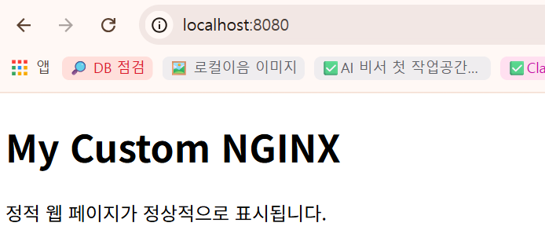
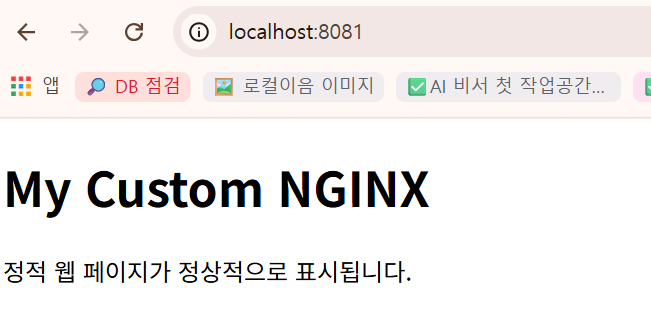

# 🖥️ 개발 워크스테이션 구축 미션


## 목차

- [1. 실행 환경](#1-실행-환경)
- [2. 수행 항목 체크리스트](#2-수행-항목-체크리스트)
- [3. WSL2 설치 및 Ubuntu 진입](#3-wsl2-설치-및-ubuntu-진입)
- [4. Ubuntu Bash 터미널 조작 로그](#4-ubuntu-bash-터미널-조작-로그)
- [5. Docker 설치 및 기본 점검](#5-docker-설치-및-기본-점검)
- [6. 컨테이너 실행 실습](#6-컨테이너-실행-실습)
- [7. Dockerfile 기반 커스텀 이미지](#7-dockerfile-기반-커스텀-이미지)
- [8. 바인드 마운트 반영 확인 (Ubuntu Bash)](#8-바인드-마운트-반영-확인-ubuntu-bash)
- [9. Docker 볼륨 영속성 검증](#9-docker-볼륨-영속성-검증)
- [10. Git·GitHub 연동](#10-gitgithub-연동)
- [11. 트러블슈팅](#11-트러블슈팅)
- [12. 학습 정리](#12-학습-정리)
- [13. 참고 명령어](#13-참고-명령어)
- [14. 디렉터리 구조](#14-디렉터리-구조)

## Ⅰ. 프로젝트 개요 및 실행 환경

### 📌 프로젝트 개요

터미널(CLI), Docker(컨테이너), Git/GitHub(버전 관리)를 직접 설정해 재현 가능한 개발 환경을 구축한다.

| 핵심 도구 | 역할 |
|-----------|------|
| Linux CLI (WSL2 Ubuntu) | 작업 디렉터리·권한 관리 |
| Docker | 재현 가능한 컨테이너 실행 환경 |
| Git / GitHub | 로컬 버전 관리 및 원격 협업 |

### 1. 실행 환경

| 항목 | 확인 내용 |
|------|------|
| Windows | `10.0.26100.9168` (wsl --version 표시값) |
| PowerShell | 버전 확인 전 |
| Linux Shell | Ubuntu Bash |
| WSL | `2.7.11.0`, 커널 `6.18.33.2-2` |
| Linux 배포판 | Ubuntu `26.04.1 LTS` (`VERSION_ID=26.04`) |
| Docker | Docker Desktop `4.99.0`, Docker CLI·Engine `29.9.3` |
| Git | `2.55.0.windows.1`, `main` → `origin/main` |

<pre style="border: 1px solid #d0d7de; border-radius: 6px; padding: 12px; background: #f6f8fa; white-space: pre-wrap; overflow-wrap: anywhere; color: #1f2328;"><code style="color: inherit;">PS C:\Users\UserK&gt; <span style="color: #0969da;">pwd</span></code></pre>

```text
Path
----
C:\Users\UserK
```

### 2. 수행 항목 체크리스트

| 수행 항목                                                                      | 완료  |
| -------------------------------------------------------------------------- | :-: |
| WSL2 설치 및 Ubuntu 진입 확인                                                     |  ☑  |
| 터미널 기본 조작 (경로 확인 / 파일 생성·복사·이동·삭제)                                         |  ☑  |
| 파일·디렉터리 권한 변경 실습 (<span style="color: #0969da;"><code>chmod</code></span>) |  ☑  |
| Docker 설치 및 기본 점검 (`--version` / `info`)                                   |  ☑  |
| `hello-world` 컨테이너 실행                                                      |  ☑  |
| Ubuntu 컨테이너 진입 및 내부 명령 수행                                                  |  ☑  |
| Dockerfile 작성 및 커스텀 이미지 빌드                                                 |  ☑  |
| 포트 매핑 실행 및 브라우저 접속 확인 (2회)                                                 |  ☑  |
| 바인드 마운트 반영 확인 (변경 전·후 비교)                                                  |  ☑  |
| Docker 볼륨 생성 및 영속성 검증 (컨테이너 삭제 전·후 비교)                                     |  ☑  |
| Git 저장소 작성자 정보 및 main 브랜치 확인                                      |  ☑  |
| GitHub 로그인·저장소 연동 및 업로드 확인                                         |  ☑  |

## Ⅱ. WSL·Ubuntu 및 기본 명령 실습

### 3. WSL2 설치 및 Ubuntu 진입

> Windows에서 Linux CLI를 사용하기 위해 WSL2 Ubuntu를 실행한다.

#### 3-1. WSL2 설치 확인

<pre style="border: 1px solid #d0d7de; border-radius: 6px; padding: 12px; background: #f6f8fa; white-space: pre-wrap; overflow-wrap: anywhere; color: #1f2328;"><code style="color: inherit;"># PowerShell에서 실행
# WSL 버전 확인
<span style="color: #0969da;">wsl --version</span></code></pre>

```text
WSL 버전: 2.7.11.0
커널 버전: 6.18.33.2-2
WSLg 버전: 1.0.73.2
MSRDC 버전: 1.2.7214
Direct3D 버전: 1.611.1-81528511
DXCore 버전: 10.0.26100.1-240331-1435.ge-release
Windows 버전: 10.0.26100.9168
```

<pre style="border: 1px solid #d0d7de; border-radius: 6px; padding: 12px; background: #f6f8fa; white-space: pre-wrap; overflow-wrap: anywhere; color: #1f2328;"><code style="color: inherit;" class="powershell"># 설치된 배포판 목록 확인
<span style="color: #0969da;">wsl --list --verbose</span></code></pre>

```text
  NAME      STATE           VERSION
* Ubuntu    Running         2
```

#### 3-2. Ubuntu 설치 (미설치 시)

<pre style="border: 1px solid #d0d7de; border-radius: 6px; padding: 12px; background: #f6f8fa; white-space: pre-wrap; overflow-wrap: anywhere; color: #1f2328;"><code style="color: inherit;" class="powershell"># PowerShell에서 실행
# Ubuntu 설치
<span style="color: #0969da;">wsl --install -d Ubuntu</span></code></pre>

```text
다운로드 중: Ubuntu
설치 중: Ubuntu
배포가 설치되었습니다. 'wsl.exe -d Ubuntu'을(를) 통해 시작할 수 있습니다.
Ubuntu 시작하는 중...
Provisioning the new WSL instance Ubuntu
This might take a while...
Create a default Unix user account: userk
New password:
Retype new password:
passwd: password updated successfully
usermod: no changes
```

<pre style="border: 1px solid #d0d7de; border-radius: 6px; padding: 12px; background: #f6f8fa; white-space: pre-wrap; overflow-wrap: anywhere; color: #1f2328;"><code style="color: inherit;" class="powershell"># 설치 가능한 배포판 목록 확인
<span style="color: #0969da;">wsl --list --online</span></code></pre>

[목록 출력](./logs/01-wsl-online.md)

#### 3-3. Ubuntu 진입

<pre style="border: 1px solid #d0d7de; border-radius: 6px; padding: 12px; background: #f6f8fa; white-space: pre-wrap; overflow-wrap: anywhere; color: #1f2328;"><code style="color: inherit;" class="powershell"># PowerShell에서 Ubuntu로 전환
<span style="color: #0969da;">wsl -d Ubuntu</span></code></pre>

```text
userk@Win11-01:/mnt/c/Users/UserK$
```

<pre style="border: 1px solid #d0d7de; border-radius: 6px; padding: 12px; background: #f6f8fa; white-space: pre-wrap; overflow-wrap: anywhere; color: #1f2328;"><code style="color: inherit;" class="bash"># Ubuntu 진입 후 확인
# Ubuntu 버전 확인
<span style="color: #0969da;">cat /etc/os-release</span></code></pre>

```text
PRETTY_NAME="Ubuntu 26.04.1 LTS"
NAME="Ubuntu"
VERSION_ID="26.04"
VERSION="26.04.1 LTS (Resolute Raccoon)"
VERSION_CODENAME=resolute
ID=ubuntu
ID_LIKE=debian
HOME_URL="https://www.ubuntu.com/"
SUPPORT_URL="https://help.ubuntu.com/"
BUG_REPORT_URL="https://bugs.launchpad.net/ubuntu/"
PRIVACY_POLICY_URL="https://www.ubuntu.com/legal/terms-and-policies/privacy-policy"
UBUNTU_CODENAME=resolute
LOGO=ubuntu-logo
```

<pre style="border: 1px solid #d0d7de; border-radius: 6px; padding: 12px; background: #f6f8fa; white-space: pre-wrap; overflow-wrap: anywhere; color: #1f2328;"><code style="color: inherit;" class="bash"># 소문자 변수 shell 확인 (SHELL과 다른 변수)
userk@Win11-01:/mnt/c/Users/UserK$ <span style="color: #0969da;">echo $shell</span></code></pre>

```text
userk@Win11-01:/mnt/c/Users/UserK$
```

<pre style="border: 1px solid #d0d7de; border-radius: 6px; padding: 12px; background: #f6f8fa; white-space: pre-wrap; overflow-wrap: anywhere; color: #1f2328;"><code style="color: inherit;" class="bash"># 현재 셸 확인
<span style="color: #0969da;">echo $SHELL</span></code></pre>

```text
/bin/bash
```

<pre style="border: 1px solid #d0d7de; border-radius: 6px; padding: 12px; background: #f6f8fa; white-space: pre-wrap; overflow-wrap: anywhere; color: #1f2328;"><code style="color: inherit;" class="bash"># 현재 사용자 확인
<span style="color: #0969da;">whoami</span></code></pre>

```text
userk
```

#### 3-4. WSL2와 Windows 경로 관계

| 구분 | 경로 |
|------|------|
| Windows 사용자 폴더 | `C:\Users\UserK` |
| Ubuntu에서 접근한 Windows 경로 | `/mnt/c/Users/UserK` |
| Ubuntu 홈 | `/home/userk` |

### 4. Ubuntu Bash 터미널 조작 로그

> 아래 명령은 Ubuntu Bash에서 실행한다.

#### 4-1. Ubuntu Bash 기본 조작

<pre style="border: 1px solid #d0d7de; border-radius: 6px; padding: 12px; background: #f6f8fa; white-space: pre-wrap; overflow-wrap: anywhere; color: #1f2328;"><code style="color: inherit;" class="bash">userk@Win11-01:/mnt/c/Users/UserK$ <span style="color: #0969da;">ls -la</span></code></pre>

[전체 목록 출력](./logs/02-ubuntu-ls-la.md)

<pre style="border: 1px solid #d0d7de; border-radius: 6px; padding: 12px; background: #f6f8fa; white-space: pre-wrap; overflow-wrap: anywhere; color: #1f2328;"><code style="color: inherit;" class="bash">userk@Win11-01:/mnt/c/Users/UserK$ <span style="color: #0969da;">pwd</span></code></pre>

```text
/mnt/c/Users/UserK
```

<pre style="border: 1px solid #d0d7de; border-radius: 6px; padding: 12px; background: #f6f8fa; white-space: pre-wrap; overflow-wrap: anywhere; color: #1f2328;"><code style="color: inherit;" class="bash">
# 실습용 디렉터리를 만든다. -p는 중간 경로도 함께 만든다.
<span style="color: #0969da;">mkdir -p ~/workspace/practice</span>
# 생성한 실습용 디렉터리로 이동한다.
<span style="color: #0969da;">cd ~/workspace/practice</span>
# 이동이 되었는지 현재 경로를 확인한다.
<span style="color: #0969da;">pwd</span>
# 빈 파일을 만들어 파일 조작 실습에 사용한다.
<span style="color: #0969da;">touch hello.txt</span>
# 파일 생성 여부와 권한&#183;크기를 확인한다.
<span style="color: #0969da;">ls -la hello.txt</span>
# 파일에 문장을 쓰고 기존 내용이 있으면 덮어쓴다.
<span style="color: #0969da;">echo &quot;Hello, Dev Workstation!&quot; &gt; hello.txt</span>
# 파일에 적은 내용을 읽어 확인한다.
<span style="color: #0969da;">cat hello.txt</span>
# 원본 파일을 복사해 백업 파일을 만든다.
<span style="color: #0969da;">cp hello.txt hello_backup.txt</span>
# 백업 파일을 새 이름으로 이동한다.
<span style="color: #0969da;">mv hello_backup.txt renamed.txt</span>
# 원본과 이동한 파일이 있는지 확인한다.
<span style="color: #0969da;">ls -la</span>
# 실습에서 만든 파일만 삭제한다.
<span style="color: #0969da;">rm renamed.txt</span>
# 삭제가 반영됐는지 목록을 다시 확인한다.
<span style="color: #0969da;">ls -la</span></code></pre>

| Ubuntu Bash 기본 조작 로그 |
|---|
| [Ubuntu Bash 기본 조작 로그 확인](./logs/03-terminal-practice.md) |

#### 4-2. 권한 실습

<span style="color: #8250df;">permission(권한)</span>: 파일·디렉터리에 대한 읽기·쓰기·실행 범위.<br>
<span style="color: #8250df;">touch</span>: 파일이 없으면 빈 파일을 만드는 명령.<br>
<span style="color: #8250df;">chmod</span>: 파일·디렉터리 권한을 변경하는 명령.

<pre style="border: 1px solid #d0d7de; border-radius: 6px; padding: 12px; background: #f6f8fa; white-space: pre-wrap; overflow-wrap: anywhere; color: #1f2328;"><code style="color: inherit;" class="bash"># 빈 파일을 만든다.
<span style="color: #0969da;">touch permission-file.txt</span>
# 파일의 현재 읽기&#183;쓰기&#183;실행 권한을 확인한다.
<span style="color: #0969da;">ls -l permission-file.txt</span>
# 파일을 소유자만 읽고 쓰도록 변경한다.
<span style="color: #0969da;">chmod 600 permission-file.txt</span>
# 변경한 파일 권한을 확인한다.
<span style="color: #0969da;">ls -l permission-file.txt</span>
# 파일을 소유자는 읽고 쓰며 모두 읽을 수 있게 변경한다.
<span style="color: #0969da;">chmod 644 permission-file.txt</span>
# 최종 파일 권한을 확인한다.
<span style="color: #0969da;">ls -l permission-file.txt</span>
# 디렉터리 권한 실습용 폴더를 만든다.
<span style="color: #0969da;">mkdir permission-dir</span>
# 디렉터리 자체의 권한을 확인한다.
<span style="color: #0969da;">ls -ld permission-dir</span>
# 소유자만 디렉터리에 접근&#183;수정하도록 변경한다.
<span style="color: #0969da;">chmod 700 permission-dir</span>
# 변경한 디렉터리 권한을 확인한다.
<span style="color: #0969da;">ls -ld permission-dir</span></code></pre>

| Ubuntu Bash 권한 실습 기록 |
|---|
| [명령과 권한 표시 확인](./logs/04-ubuntu-permission.md) |

<span style="color: #8250df;">확인 내용</span>: `/mnt/c`에서는 권한 변경이 표시되지 않았지만 Ubuntu 홈 경로에서 `chmod 600 permission.file.txt` 후 `-rw-------`를 확인했다. 파일명 오타로 발생한 두 번의 조회·변경 실패와 최종 성공은 [권한 실습 기록](./logs/04-ubuntu-permission.md)에 정리했다.

권한 숫자는 소유자·그룹·기타 사용자 순서로 표시한다. `r=4`(읽기), `w=2`(쓰기), `x=1`(실행)이며, 필요한 값을 더해 각 자리 숫자를 만든다.

| 권한                                       | 소유자                         | 그룹          | 기타 사용자      |
| ---------------------------------------- | --------------------------- | ----------- | ----------- |
| <span style="color: #8250df;">600</span> | `6` = 읽기(4) + 쓰기(2)         | `0` = 권한 없음 | `0` = 권한 없음 |
| <span style="color: #8250df;">644</span> | `6` = 읽기(4) + 쓰기(2)         | `4` = 읽기    | `4` = 읽기    |
| <span style="color: #8250df;">700</span> | `7` = 읽기(4) + 쓰기(2) + 실행(1) | `0` = 권한 없음 | `0` = 권한 없음 |

디렉터리의 실행(`x`) 권한은 디렉터리에 들어가거나 내부 항목에 접근할 때 필요하다.

## Ⅲ. Docker·웹 서버 및 저장소 실습

### 5. Docker 설치 및 기본 점검

| 구분                | 과제 요구 및 현재 환경 적용                                                                                                                                                                                                                                |
| ----------------- | ----------------------------------------------------------------------------------------------------------------------------------------------------------------------------------------------------------------------------------------------- |
| 과제 요구             | Docker 설치와 기본 점검.                                                                                                                                                                                                                               |
| 현재 상태             | Docker Desktop 실행 중. Ubuntu에서 Docker Engine 29.9.3 연결 및 이미지 목록 조회 성공. 이미지 0개·컨테이너 0개. 프로젝트 새 터미널을 Ubuntu 기본값으로 설정.                                                                                                                              |
| Docker Desktop 설치 | Windows에서 설치 프로그램 실행. 설치 명령을 사용하는 경우 PowerShell에서 실행.                                                                                                                                                                                           |
| 구성 방식             | WSL 2 엔진과 Ubuntu 연동은 서로 다른 설정이며, 아래 5-2절에서 구분.                                                                                                                                                                                                  |
| Ubuntu 연동         | `Settings > WSL integration > Enable integration with additional distros > Ubuntu`에서 설정.                                                                                                                                                        |
| Docker 점검 명령      | <span style="color: #8250df;">Ubuntu Bash</span>에서 실행. <span style="color: #0969da;"><code>docker --version</code></span>과 <span style="color: #0969da;"><code>docker info</code></span>는 PowerShell에서도 실행 가능하지만, 이 README의 실습은 Ubuntu Bash 기준. |

#### 5-1. Docker Desktop 설치 (Windows PowerShell)

1. [Docker 공식 Windows 설치 안내](https://docs.docker.com/desktop/setup/install/windows-install/)에서 설치 프로그램을 내려받는다.
2. 내려받은 파일이 `Downloads` 폴더에 있을 때 PowerShell에서 사용자별로 설치한다.

<pre style="border: 1px solid #d0d7de; border-radius: 6px; padding: 12px; background: #f6f8fa; white-space: pre-wrap; overflow-wrap: anywhere; color: #1f2328;"><code style="color: inherit;" class="powershell"># Downloads 폴더로 이동
<span style="color: #0969da;">Set-Location "$env:USERPROFILE\Downloads"</span>

# Docker Desktop 사용자별 설치
<span style="color: #0969da;">& ".\Docker Desktop Installer.exe" install --user</span></code></pre>

[Docker Desktop 설치 기록](./logs/05-docker-install.txt)



3. 설치 후 시작 메뉴에서 Docker Desktop을 실행한다.

#### 5-2. WSL 2 엔진과 Ubuntu 연동 구분

| 구분 | WSL 2 엔진 | Ubuntu용 WSL 연동 |
| --- | --- | --- |
| 하는 일 | Docker Desktop의 Docker Engine을 WSL 2 환경에서 실행 | Ubuntu Bash에서 Docker 명령으로 엔진 사용 |
| 설정 | Docker Desktop에서 WSL 2 엔진 선택 | `Settings > WSL integration > Enable integration with additional distros > Ubuntu`에서 Ubuntu 선택 |
| 위치·역할 | 엔진은 Docker Desktop이 관리하는 `docker-desktop` 배포판에서 실행 | Ubuntu 배포판에 Docker Engine을 설치하는 설정이 아님 |

**설정 경로**: Docker Desktop → `Settings` → `WSL integration` → `Enable integration with additional distros`에서 `Ubuntu`를 선택한다.







여기서 두 설정은 **Docker Desktop에서 WSL 2 엔진 사용**과 **WSL integration에서 Ubuntu 선택**을 뜻한다. 첫 설정은 엔진의 실행 방식이고, 둘째 설정은 Ubuntu Bash가 그 엔진을 사용하도록 연결한다. 설정 후 Ubuntu Bash에서 실행한 <span style="color: #0969da;">`docker` 명령</span>은 Docker Desktop이 관리하는 `docker-desktop`의 Docker Engine에 전달된다. Ubuntu 안에 Docker Engine을 별도로 설치하는 것은 아니다.

[Docker WSL 2 연동 안내](https://docs.docker.com/desktop/features/wsl)


#### 5-3. Docker 기본 점검 (Ubuntu Bash)

<span style="color: #8250df;">Docker image</span>는 Docker 설치 프로그램이 아니라 컨테이너를 만들 때 사용하는 템플릿이다. <span style="color: #0969da;"><code>docker images</code></span>는 내려받은 이미지 목록을 확인하는 명령이다.

<span style="color: #0969da;"><code>docker --version</code></span>은 CLI 버전을, <span style="color: #0969da;"><code>docker info</code></span>는 엔진 연결 여부를 확인한다.

<pre style="border: 1px solid #d0d7de; border-radius: 6px; padding: 12px; background: #f6f8fa; white-space: pre-wrap; overflow-wrap: anywhere; color: #1f2328;"><code style="color: inherit;" class="bash"># Docker CLI가 설치되어 있고 실행 가능한지 버전을 확인한다.
<span style="color: #0969da;">docker --version</span>
Docker version 29.9.3, build 5457199</code></pre>

<pre style="border: 1px solid #d0d7de; border-radius: 6px; padding: 12px; background: #f6f8fa; white-space: pre-wrap; overflow-wrap: anywhere; color: #1f2328;"><code style="color: inherit;" class="bash"># Docker 엔진이 응답하는지와 엔진 정보를 확인한다.
<span style="color: #0969da;">docker info</span>
Server Version: 29.9.3
Containers: 0
Images: 0</code></pre>

<pre style="border: 1px solid #d0d7de; border-radius: 6px; padding: 12px; background: #f6f8fa; white-space: pre-wrap; overflow-wrap: anywhere; color: #1f2328;"><code style="color: inherit;" class="bash"># 내려받은 이미지 목록을 확인한다.
<span style="color: #0969da;">docker images</span>
IMAGE   ID             DISK USAGE   CONTENT SIZE   EXTRA</code></pre>

<pre style="border: 1px solid #d0d7de; border-radius: 6px; padding: 12px; background: #f6f8fa; white-space: pre-wrap; overflow-wrap: anywhere; color: #1f2328;"><code style="color: inherit;" class="bash"># 현재 실행 중인 컨테이너를 확인한다.
<span style="color: #0969da;">docker ps</span>
CONTAINER ID   IMAGE     COMMAND   CREATED   STATUS    PORTS     NAMES</code></pre>

<pre style="border: 1px solid #d0d7de; border-radius: 6px; padding: 12px; background: #f6f8fa; white-space: pre-wrap; overflow-wrap: anywhere; color: #1f2328;"><code style="color: inherit;" class="bash"># 종료된 컨테이너를 포함해 전체 목록을 확인한다.
<span style="color: #0969da;">docker ps -a</span>
CONTAINER ID   IMAGE     COMMAND   CREATED   STATUS    PORTS     NAMES</code></pre>

- [Docker 기본 점검 전체 로그: CLI·엔진 버전, docker info, 최초 소켓 권한 오류와 점검 과정](./logs/07-docker-basic-check.md)
- [Windows·Ubuntu Docker CLI 비교: context·연결 주소 차이, 이미지 목록 조회 및 수정 후 확인](./logs/08-docker-repair.md)
- [컨테이너 생성 후 점검 명령: 이름 확인, 출력 로그 조회와 자원 사용량 확인](./docs/container-log-commands.md)

### 6. 컨테이너 실행 실습

#### 6-1. hello-world

<span style="color: #0969da;"><code>docker run</code></span>은 이미지를 내려받아 컨테이너를 만들고 실행한다. <span style="color: #0969da;"><code>hello-world</code></span>는 이미지 이름이며, 로컬에 없으면 기본 저장소인 Docker Hub의 `library/hello-world`에서 내려받는다.

<pre style="border: 1px solid #d0d7de; border-radius: 6px; padding: 12px; background: #f6f8fa; white-space: pre-wrap; overflow-wrap: anywhere; color: #1f2328;"><code style="color: inherit;" class="bash"># hello-world 이미지를 내려받아 컨테이너로 실행한다.
<span style="color: #0969da;">docker run hello-world</span>
Unable to find image 'hello-world:latest' locally
latest: Pulling from library/hello-world
4f55086f7dd0: Pull complete
d5e71e642bf5: Download complete
Digest: sha256:c567b231f65614688711a75f31518a064258a51d442117a3e771a3a8fdba78ef
Status: Downloaded newer image for hello-world:latest

Hello from Docker!
This message shows that your installation appears to be working correctly.

To generate this message, Docker took the following steps:
 1. The Docker client contacted the Docker daemon.
 2. The Docker daemon pulled the &quot;hello-world&quot; image from the Docker Hub.
    (amd64)
 3. The Docker daemon created a new container from that image which runs the
    executable that produces the output you are currently reading.
 4. The Docker daemon streamed that output to the Docker client, which sent it
    to your terminal.</code></pre>

로컬에 이미지가 없어 Docker Hub에서 `hello-world:latest`를 내려받았고, 그 이미지로 컨테이너를 만들어 실행했다. `Hello from Docker!` 출력은 Docker 클라이언트와 엔진이 동작하고 컨테이너 출력이 터미널에 전달된 것을 보여준다.

#### 6-2. Ubuntu 컨테이너 진입

<pre style="border: 1px solid #d0d7de; border-radius: 6px; padding: 12px; background: #f6f8fa; white-space: pre-wrap; overflow-wrap: anywhere; color: #1f2328;"><code style="color: inherit;" class="bash"># Ubuntu 이미지로 대화형 컨테이너를 실행해 내부 셸에 진입한다.
<span style="color: #0969da;">docker run -it ubuntu bash</span>
root@2adb9b993bcc:/#</code></pre>

실행 후 컨테이너 프롬프트가 나타나면 Ubuntu 컨테이너 안에 들어온 것이다.

앞서 실행한 <span style="color: #0969da;"><code>docker pull ubuntu:latest</code></span>은 Ubuntu 이미지를 Docker Hub에서 내려받았다. <span style="color: #0969da;"><code>docker run -it ubuntu bash</code></span>는 내려받은 이미지로 새 컨테이너를 만들고 시작한 뒤, 그 안의 Bash 셸을 연다. 별도의 컨테이너 생성 명령은 필요하지 않다.

| 화면에 보이는 프롬프트           | 현재 위치         | 여기서 입력하는 것                               |
| ---------------------- | ------------- | ---------------------------------------- |
| `userk@Win11-01:...$`  | WSL Ubuntu    | `docker run`, `docker ps` 등 Docker 관리 명령 |
| `root@2adb9b993bcc:/#` | Ubuntu 컨테이너 안 | `ls`, `cat`, `echo` 등 컨테이너 내부 명령         |

| 명령                                                       | 의미                                                                        |
| -------------------------------------------------------- | ------------------------------------------------------------------------- |
| <span style="color: #0969da;"><code>run</code></span>    | 지정한 이미지로 컨테이너를 만들고 실행한다.                                                  |
| <span style="color: #0969da;"><code>-it</code></span>    | `-i`는 키보드 입력을 컨테이너에 전달하고, `-t`는 터미널을 연결한다. 함께 쓰면 컨테이너 안에서 대화형으로 작업할 수 있다. |
| <span style="color: #0969da;"><code>ubuntu</code></span> | 컨테이너를 만들 때 사용할 Ubuntu 이미지다.                                               |
| <span style="color: #0969da;"><code>bash</code></span>   | 컨테이너가 시작할 명령이며, Ubuntu 컨테이너 안의 Bash 셸을 연다.                                |

[컨테이너 root 관리자 계정·권한 범위·일반 사용자와의 차이·프롬프트 및 자동 이름 설명](./docs/root-admin-account.md)

아래 명령은 Ubuntu 컨테이너 안에서 실행한다.

<pre style="border: 1px solid #d0d7de; border-radius: 6px; padding: 12px; background: #f6f8fa; white-space: pre-wrap; overflow-wrap: anywhere; color: #1f2328;"><code style="color: inherit;" class="bash"># 컨테이너 안의 파일과 디렉터리를 확인한다.
<span style="color: #0969da;">ls</span>
bin   dev  home  lib64  mnt  proc  run   srv  tmp  var
boot  etc  lib   media  opt  root  sbin  sys  usr</code></pre>

<pre style="border: 1px solid #d0d7de; border-radius: 6px; padding: 12px; background: #f6f8fa; white-space: pre-wrap; overflow-wrap: anywhere; color: #1f2328;"><code style="color: inherit;" class="bash"># 컨테이너의 Linux 배포판 정보를 확인한다.
<span style="color: #0969da;">cat /etc/os-release</span>
PRETTY_NAME=&quot;Ubuntu 26.04.1 LTS&quot;
NAME=&quot;Ubuntu&quot;
VERSION_ID=&quot;26.04&quot;
VERSION=&quot;26.04.1 LTS (Resolute Raccoon)&quot;
VERSION_CODENAME=resolute
ID=ubuntu
ID_LIKE=debian
HOME_URL=&quot;https://www.ubuntu.com/&quot;
SUPPORT_URL=&quot;https://help.ubuntu.com/&quot;
BUG_REPORT_URL=&quot;https://bugs.launchpad.net/ubuntu/&quot;
UBUNTU_CODENAME=resolute
LOGO=ubuntu-logo</code></pre>

<pre style="border: 1px solid #d0d7de; border-radius: 6px; padding: 12px; background: #f6f8fa; white-space: pre-wrap; overflow-wrap: anywhere; color: #1f2328;"><code style="color: inherit;" class="bash"># 컨테이너 안에서 명령 실행을 확인한다.
<span style="color: #0969da;">echo &quot;hello from container&quot;</span>
hello from container</code></pre>

| 명령                                                                                      | 의미                                      |
| --------------------------------------------------------------------------------------- | --------------------------------------- |
| <span style="color: #0969da;"><code>ls</code></span>                                    | 현재 위치인 컨테이너의 최상위 디렉터리에 있는 파일과 폴더를 나열한다. |
| <span style="color: #0969da;"><code>cat /etc/os-release</code></span>                   | 운영체제 정보가 적힌 파일 내용을 화면에 출력한다.            |
| <span style="color: #0969da;"><code>echo &quot;hello from container&quot;</code></span> | 따옴표 안의 문장을 화면에 출력한다.                    |

<pre style="border: 1px solid #d0d7de; border-radius: 6px; padding: 12px; background: #f6f8fa; white-space: pre-wrap; overflow-wrap: anywhere; color: #1f2328;"><code style="color: inherit;" class="bash"># Ubuntu 컨테이너의 Bash를 종료하고 Ubuntu Bash로 돌아간다.
root@2adb9b993bcc:/# <span style="color: #0969da;">exit</span>
exit
userk@Win11-01:/mnt/c/all in one/e1-1$</code></pre>

`exit`는 컨테이너 안에서 실행 중인 Bash를 끝낸다. Bash가 이 컨테이너의 주 실행 프로그램이므로 셸을 나가면 컨테이너도 멈춘다. 프롬프트가 WSL Ubuntu의 `userk@Win11-01:/mnt/c/all in one/e1-1$`로 돌아왔으며, 컨테이너는 삭제되지 않고 `exited (0)` 상태로 남아 있음을 확인했다.

현재 목록에는 Ubuntu 컨테이너 하나가 실행 중이고, 종료한 Ubuntu 컨테이너와 `hello-world` 컨테이너는 종료 상태로 남아 있다.

<pre style="border: 1px solid #d0d7de; border-radius: 6px; padding: 12px; background: #f6f8fa; white-space: pre-wrap; overflow-wrap: anywhere; color: #1f2328;"><code style="color: inherit;" class="bash"># 생성된 컨테이너와 실행 상태를 확인한다.
<span style="color: #0969da;">docker ps -a --format 'table {{.ID}}\t{{.Image}}\t{{.State}}\t{{.Names}}'</span>
CONTAINER ID   IMAGE         STATE     NAMES
e2af24afba87   ubuntu        running   gallant_hopper
2adb9b993bcc   ubuntu        exited    charming_greider
f2c832204f4a   hello-world   exited    fervent_keldy</code></pre>

#### 6-3. attach와 exec

| 명령                                                                | 설명          | 종료 시 컨테이너         |
| ----------------------------------------------------------------- | ----------- | ----------------- |
| <span style="color: #0969da;"><code>docker attach</code></span>   | 메인 프로세스에 연결 | 메인 프로세스가 종료될 수 있음 |
| <span style="color: #0969da;"><code>docker exec -it</code></span> | 새 프로세스로 진입  | 컨테이너 유지           |

두 명령 모두 실행 중인 컨테이너에 들어갈 때 쓰지만, 연결 방식이 다르다. <span style="color: #0969da;"><code>attach</code></span>는 컨테이너를 시작한 기존 주 프로세스의 터미널에 다시 연결한다. <span style="color: #0969da;"><code>exec</code></span>는 실행 중인 컨테이너 안에 별도의 명령(예: 새 Bash)을 시작한다. 그래서 `exec` 셸에서 `exit`해도 주 프로세스가 계속 실행 중이면 컨테이너는 유지된다.

`gallant_hopper`는 `docker ps -a`에서 확인한 실행 중 컨테이너 이름이다. 아래 두 명령은 WSL Ubuntu에서 실행했고, 두 터미널 모두 같은 컨테이너의 `root` 셸에 연결됐다.

<pre style="border: 1px solid #d0d7de; border-radius: 6px; padding: 12px; background: #f6f8fa; white-space: pre-wrap; overflow-wrap: anywhere; color: #1f2328;"><code style="color: inherit;" class="bash"># 왼쪽 터미널: 컨테이너 안의 새 Bash를 실행
userk@Win11-01:/mnt/c/all in one/e1-1$ <span style="color: #0969da;">docker exec -it gallant_hopper bash</span>
root@e2af24afba87:/#</code></pre>

<pre style="border: 1px solid #d0d7de; border-radius: 6px; padding: 12px; background: #f6f8fa; white-space: pre-wrap; overflow-wrap: anywhere; color: #1f2328;"><code style="color: inherit;" class="bash"># 오른쪽 터미널: 기존 주 프로세스에 연결
userk@Win11-01:/mnt/c/all in one/e1-1$ <span style="color: #0969da;">docker attach gallant_hopper</span>
root@e2af24afba87:/#</code></pre>

[](./logs/10-docker-attach-exec.png)

`docker attach`로 컨테이너 안에 들어간 다음에는 화면이 `root@...`로 바뀐다. 이 상태는 컨테이너 안이므로 Docker 관리 명령인 `docker exec`를 입력하지 않는다. 컨테이너를 계속 실행한 채 분리하려면 Docker 기본 키인 <span style="color: #0969da;"><code>Ctrl+P</code></span>를 누른 다음 <span style="color: #0969da;"><code>Ctrl+Q</code></span>를 누른다. VS Code가 단축키를 먼저 처리해 이 키가 전달되지 않으면 현재 터미널은 그대로 두고 새 `Ubuntu (WSL)` 터미널을 연다. 새 터미널의 `userk@...$` 프롬프트에서 Docker 관리 명령을 실행할 수 있다. [Docker attach 공식 설명](https://docs.docker.com/reference/cli/docker/container/attach/)

### 7. Dockerfile 기반 커스텀 이미지

#### 7-1. 베이스 이미지

이번 실습은 HTML 등 정적 웹 콘텐츠를 제공하므로 NGINX 공식 이미지를 베이스로 선택했다. <span style="color: #8250df;">베이스 이미지</span>는 새 이미지를 만들 때 출발점으로 사용하는 이미지다. `nginx`는 웹 서버가 준비된 공식 이미지이고, `alpine` 태그는 Alpine Linux 기반의 비교적 작은 변형이다. Dockerfile에서 웹 파일을 이미지에 복사한 뒤 NGINX가 이를 제공하도록 구성할 예정이다. [NGINX 공식 이미지 설명](https://hub.docker.com/_/nginx)

<pre style="border: 1px solid #d0d7de; border-radius: 6px; padding: 12px; background: #f6f8fa; white-space: pre-wrap; overflow-wrap: anywhere; color: #1f2328;"><code style="color: inherit;" class="bash"># Ubuntu Bash에서 NGINX Alpine 이미지의 최신 상태를 확인한다.
userk@Win11-01:/mnt/c/all in one/e1-1$ <span style="color: #0969da;">docker pull nginx:alpine</span>
alpine: Pulling from library/nginx
Digest: sha256:713fc2ebfd92e8217db451477182ee91944b123d2b1ee9fd5a8c6e91ca6c3a11
Status: Image is up to date for nginx:alpine
docker.io/library/nginx:alpine</code></pre>

Ubuntu Bash에서 명령을 다시 실행해 로컬 이미지가 최신 상태임을 확인했다. 첫 다운로드와 이미지 세부 정보는 [NGINX 베이스 이미지 점검 로그](./logs/11-nginx-base-image.md)에 기록했다. 현재 Docker Engine이 보유한 디스크 사용량은 94.5 MB, 콘텐츠 크기는 27.3 MB이며 이미지 세부 정보는 Linux/amd64다.

#### 7-2. 디렉터리 구조

최종적으로 구성할 폴더 구조:

```text
project/
├── Dockerfile
├── site/
│   └── index.html
└── README.md
```

WSL Ubuntu의 `userk@...$` 프롬프트에서 과제 폴더로 이동해 `project/site`를 만든다. `root@...#`가 보이는 컨테이너 안에서는 만들지 않는다.

<pre style="border: 1px solid #d0d7de; border-radius: 6px; padding: 12px; background: #f6f8fa; white-space: pre-wrap; overflow-wrap: anywhere; color: #1f2328;"><code style="color: inherit;" class="bash"># WSL Ubuntu의 과제 폴더로 이동
<span style="color: #0969da;">cd &quot;/mnt/c/all in one/e1-1&quot;</span>
# Dockerfile과 웹 콘텐츠를 둘 폴더 만들기
<span style="color: #0969da;">mkdir -p project/site</span>
# 폴더가 만들어졌는지 확인
<span style="color: #0969da;">ls -d project project/site</span>
project
project/site</code></pre>

`project` 바로 아래에 `Dockerfile`을 만들고 `site/index.html`은 그 안쪽에 둔다. VS Code 탐색기에서 `project\site`처럼 한 줄로 보일 수 있는데, 이는 중첩 폴더를 접어 표시한 것이다. VS Code의 PowerShell/Ubuntu 선택은 **터미널에서 명령을 실행할 환경**을 고르는 것이며, 파일 편집기와는 별개다. 현재 연 작업 폴더 `C:\all in one\e1-1`에 저장한 파일은 Ubuntu에서도 `/mnt/c/all in one/e1-1` 경로로 보인다.

`index.html`은 NGINX가 방문자에게 보여 줄 웹 페이지 파일이다. VS Code 탐색기에서 `project\site` 폴더를 펼쳐 `site`를 선택한 뒤 새 파일을 만들고, 이름을 `index.html`로 지정한다. 아래 HTML을 입력하고 저장한다.

```html
<!doctype html>
<html lang="ko">
<head>
  <meta charset="utf-8">
  <title>My Custom NGINX</title>
</head>
<body>
  <h1>My Custom NGINX</h1>
  <p>정적 웹 페이지가 정상적으로 표시됩니다.</p>
</body>
</html>
```

[](./logs/12-index-html.png)

#### 7-3. Dockerfile

`Dockerfile`은 터미널에 입력하는 명령이 아니라 텍스트 파일이다. `project` 바로 아래에 확장자 없이 `Dockerfile`이라는 이름으로 만들었다. 실제 파일은 [project/Dockerfile](./project/Dockerfile)이며, Windows 경로는 `C:\all in one\e1-1\project\Dockerfile`, Ubuntu에서 보이는 경로는 `/mnt/c/all in one/e1-1/project/Dockerfile`이다.

<pre style="border: 1px solid #d0d7de; border-radius: 6px; padding: 12px; background: #f6f8fa; white-space: pre-wrap; overflow-wrap: anywhere; color: #1f2328;"><code style="color: inherit;" class="dockerfile"><span style="color: #0969da;">FROM nginx:alpine</span>
<span style="color: #0969da;">LABEL org.opencontainers.image.title=&quot;my-custom-nginx&quot;</span>
<span style="color: #0969da;">ENV APP_ENV=dev</span>
<span style="color: #0969da;">COPY site/ /usr/share/nginx/html/</span>
<span style="color: #0969da;">EXPOSE 80</span></code></pre>

`project/site/index.html`을 만들고 기본 HTML 내용 저장. Dockerfile의 `COPY site/ ...`가 이 웹 파일을 NGINX의 기본 웹 폴더로 복사한다.

#### 7-4. 커스텀 항목

**커스텀 이미지**는 기존 이미지를 바탕으로 필요한 설정이나 파일을 더해 새로 구성한 이미지다. 이 실습에서는 `nginx:alpine`에 웹 페이지 파일을 복사하고 이미지 정보와 환경 변수를 추가해 `my-web:1.0` 이미지를 만들었다. 빌드와 두 웹 응답 확인까지 완료했다.

| 항목                  | 목적              |
| ------------------- | --------------- |
| `FROM nginx:alpine` | NGINX 기반 이미지 사용 |
| `LABEL`             | 이미지 메타정보 지정     |
| `ENV APP_ENV=dev`   | 환경 변수 지정        |
| `COPY site/`        | 웹 콘텐츠 복사        |
| `EXPOSE 80`         | 컨테이너 포트 표시      |

#### 7-5. 빌드 및 실행

Ubuntu Bash에서 `project` 폴더에 있을 때 빌드한다. 끝의 `.`은 현재 폴더를 <span style="color: #8250df;">빌드 컨텍스트</span>로 지정해 Docker가 이곳의 `Dockerfile`과 `site/`를 사용하게 한다.

<pre style="border: 1px solid #d0d7de; border-radius: 6px; padding: 12px; background: #f6f8fa; white-space: pre-wrap; overflow-wrap: anywhere; color: #1f2328;"><code style="color: inherit;" class="bash">userk@Win11-01:/mnt/c/all in one/e1-1/project$ <span style="color: #0969da;">docker build -t my-web:1.0 .</span>
[+] Building 1.3s (7/7) FINISHED
 => [2/2] COPY site/ /usr/share/nginx/html/ 0.1s
 => naming to docker.io/library/my-web:1.0</code></pre>

빌드 전체 출력은 [커스텀 이미지 빌드·실행 로그](./logs/15-custom-nginx-build-run.md)에 연결했다.

##### 포트 매핑 실행

> 💡 **포트 매핑이 필요한 이유**<br>
> 컨테이너는 격리된 네트워크 환경에서 실행된다.<br>
> 호스트(내 PC)에서 접근하려면 `-p 호스트포트:컨테이너포트`로<br>
> 명시적으로 연결 통로를 열어줘야 한다.

<pre style="border: 1px solid #d0d7de; border-radius: 6px; padding: 12px; background: #f6f8fa; white-space: pre-wrap; overflow-wrap: anywhere; color: #1f2328; white-space: pre-wrap; overflow-wrap: anywhere;"><code style="color: inherit;" class="bash"># 포트 매핑 실행 1 (호스트 8080 → 컨테이너 80)
<span style="color: #0969da;">docker run -d -p 8080:80 --name my-web-8080 my-web:1.0</span>
cf736d6f4fe58cf8dd657760723ce1821a7770f665c307fbeff86a78f3898f8d

# 포트 매핑 실행 2 (호스트 8081 → 컨테이너 80)
<span style="color: #0969da;">docker run -d -p 8081:80 --name my-web-8081 my-web:1.0</span>
5249359579c8e2f1b7e5012b9f171729d43b303bf9fe52c560f576ac6391efa6</code></pre>

##### 웹 응답 확인

<pre style="border: 1px solid #d0d7de; border-radius: 6px; padding: 12px; background: #f6f8fa; white-space: pre-wrap; overflow-wrap: anywhere; color: #1f2328;"><code style="color: inherit;" class="bash"># 8080 포트에서 웹 페이지 응답 확인
<span style="color: #0969da;">curl http://localhost:8080</span>
My Custom NGINX
정적 웹 페이지가 정상적으로 표시됩니다.</code></pre>

<pre style="border: 1px solid #d0d7de; border-radius: 6px; padding: 12px; background: #f6f8fa; white-space: pre-wrap; overflow-wrap: anywhere; color: #1f2328;"><code style="color: inherit;" class="bash"># 8081 포트에서 웹 페이지 응답 확인
<span style="color: #0969da;">curl http://localhost:8081</span>
My Custom NGINX
정적 웹 페이지가 정상적으로 표시됩니다.</code></pre>

| 용어 | 의미 |
|------|------|
| <span style="color: #0969da;"><code>-t my-web:1.0</code></span> | 빌드한 이미지에 `my-web`이라는 이름과 `1.0` 태그를 붙인다. |
| <span style="color: #0969da;"><code>.</code></span> | 현재 `project` 폴더를 빌드에 사용할 파일 위치로 지정한다. |
| <span style="color: #0969da;"><code>-d</code></span> | 컨테이너를 터미널과 분리해 백그라운드에서 실행한다. 명령이 끝나면 컨테이너 ID가 출력된다. |
| <span style="color: #0969da;"><code>-p 8080:80</code></span> | 컴퓨터의 8080 포트를 컨테이너의 80 포트에 연결한다. 8081 컨테이너도 같은 방식이다. |
| <span style="color: #0969da;"><code>--name</code></span> | 컨테이너에 지정한 이름을 붙인다. |
| <span style="color: #0969da;"><code>curl</code></span> | 주소에 요청을 보내고 서버가 돌려준 응답 내용을 터미널에 표시한다. |
| `localhost` | 이 컴퓨터 자신을 가리킨다. `localhost:8080`은 컴퓨터의 8080 포트로 요청한다. |

명령과 전체 응답은 [빌드·실행 전체 로그](./logs/15-custom-nginx-build-run.md)에서 확인한다.

#### 7-6. 브라우저 접속 화면

| 포트 | 화면 |
|------|------|
| 8080 | [](./logs/13-nginx-8080.png) |
| 8081 | [](./logs/14-nginx-8081.png) |

### 8. 바인드 마운트 반영 확인 (Ubuntu Bash)

**바인드 마운트**는 내 컴퓨터의 폴더를 컨테이너 안의 폴더에 연결해, 호스트 파일을 컨테이너가 직접 읽게 하는 방식이다. 이번에는 `project/site/`를 NGINX 웹 폴더에 연결한다.

| 위치 | 실제 경로 | 역할 |
|------|-----------|------|
| 호스트(내 컴퓨터) | `C:\all in one\e1-1\project\site\` | VS Code에서 웹 파일을 수정한다. |
| Ubuntu에서 보이는 호스트 경로 | `/mnt/c/all in one/e1-1/project/site/` | 위 폴더와 같은 위치다. |
| 컨테이너 | `/usr/share/nginx/html/` | NGINX가 웹 파일을 읽는다. |

**변경 흐름**: VS Code에서 `index.html` 수정 → 컨테이너가 같은 파일을 읽음 → 웹 페이지에 수정 내용 표시. 바인드 마운트로 연결했으므로 이 실습에서는 HTML을 바꿀 때마다 이미지를 다시 빌드하지 않아도 된다. `:ro`는 컨테이너에서 읽기만 하고 파일을 변경할 수 없다는 뜻이다.

#### 8-1. 이전 컨테이너 정리 및 올바른 폴더로 이동

앞선 시도에서 `bind-test`가 잘못된 폴더를 연결한 채 8082 포트를 사용하고 있다. 다시 만들기 전에 해당 컨테이너만 제거한다. 이어서 경로에 공백이 있으므로 따옴표로 감싸 `project` 폴더로 이동한다.

<pre style="border: 1px solid #d0d7de; border-radius: 6px; padding: 12px; background: #f6f8fa; white-space: pre-wrap; overflow-wrap: anywhere; color: #1f2328;"><code style="color: inherit;" class="bash"># 기존의 잘못된 연결 컨테이너와 8082 포트를 정리한다.
<span style="color: #0969da;">docker rm -f bind-test</span>
# 올바른 project 폴더로 이동한다. 경로에 공백이 있어 따옴표로 감싼다.
<span style="color: #0969da;">cd "/mnt/c/all in one/e1-1/project"</span>
# 현재 위치가 맞는지 확인한다.
<span style="color: #0969da;">pwd</span>
</code></pre>

`pwd` 결과가 `/mnt/c/all in one/e1-1/project`인지 확인한다. 이 위치에서 `$(pwd)/site`를 쓰면 호스트의 `project/site/`가 지정된다.

> **입력 중 확인**: `cd` 명령 뒤에 `>` 프롬프트가 나오면 경로를 감싼 큰따옴표가 닫히지 않아 Bash가 이어 입력을 기다리는 상태다. `Ctrl+C`로 취소한 다음, 닫는 큰따옴표까지 포함해 `cd` 명령을 다시 입력한다. 기다리는 상태에서 입력한 `pwd`는 실행되지 않고 미완성 명령에 포함될 수 있다.

**실제 진행 기록**:

| 실행 내용 | 확인된 결과 |
|-----------|-------------|
| `docker rm -f bind-test` | `bind-test` 출력. 기존 컨테이너 제거 완료. |
| 첫 `cd` 입력 | 닫는 큰따옴표가 빠져 `>` 이어쓰기 프롬프트가 표시됨. `Ctrl+C`로 취소했고 미완성 명령은 실행되지 않음. |
| 수정한 `cd` 및 `pwd` | `/mnt/c/all in one/e1-1/project` 출력. 현재 위치 확인 완료. |

#### 8-2. 호스트 폴더를 컨테이너에 연결

<pre style="border: 1px solid #d0d7de; border-radius: 6px; padding: 12px; background: #f6f8fa; white-space: pre-wrap; overflow-wrap: anywhere; color: #1f2328;"><code style="color: inherit;" class="bash"># 현재 폴더의 site를 NGINX 웹 경로에 읽기 전용으로 연결한다.
<span style="color: #0969da;">docker run -d -p 8082:80 -v &quot;$(pwd)/site:/usr/share/nginx/html:ro&quot; --name bind-test my-web:1.0</span>
# 호스트 파일을 수정하기 전 컨테이너의 응답을 확인한다.
<span style="color: #0969da;">curl http://localhost:8082</span></code></pre>

브라우저에서도 `http://localhost:8082`를 열어 변경 전 페이지를 확인한다.

#### 8-3. 호스트 파일 변경 반영 확인

VS Code에서 `project/site/index.html`을 열어 `<h1>` 안의 문구만 `바인드 마운트 변경 확인`으로 바꾸고 저장한다. `<meta charset="utf-8">`와 나머지 HTML 구조는 유지한다. 컨테이너는 읽기 전용으로 연결했으므로 파일은 호스트에서 수정한다.

<pre style="border: 1px solid #d0d7de; border-radius: 6px; padding: 12px; background: #f6f8fa; white-space: pre-wrap; overflow-wrap: anywhere; color: #1f2328;"><code style="color: inherit;" class="bash"># 수정한 호스트 파일이 웹 응답에 반영됐는지 확인한다.
<span style="color: #0969da;">curl http://localhost:8082</span></code></pre>

| 명령 부분                                                                        | 의미                                                                                  |
| ---------------------------------------------------------------------------- | ----------------------------------------------------------------------------------- |
| <span style="color: #0969da;"><code>docker rm -f bind-test</code></span>     | 앞선 시도에서 잘못 연결한 컨테이너를 지우고 8082 포트를 비운다.                                              |
| <span style="color: #0969da;"><code>cd ".../project"</code></span>           | Ubuntu Bash의 현재 위치를 `project`로 바꾼다. 경로 안 공백을 포함하므로 따옴표를 쓴다.                         |
| <span style="color: #0969da;"><code>pwd</code></span>                        | 현재 위치를 출력해 올바른 폴더에 있는지 확인한다.                                                        |
| <span style="color: #0969da;"><code>docker run</code></span>                 | 이미지로 새 컨테이너를 만들고 실행한다.                                                              |
| <span style="color: #0969da;"><code>-d</code></span>                         | 컨테이너를 터미널을 점유하지 않는 백그라운드에서 실행한다.                                                    |
| <span style="color: #0969da;"><code>-p 8082:80</code></span>                 | 포트를 연결한다. `8082`는 내 컴퓨터 쪽 포트, `80`은 컨테이너 안 NGINX의 포트다. 콜론(`:`) 왼쪽이 컴퓨터, 오른쪽이 컨테이너다. |
| <span style="color: #0969da;"><code>-v</code></span>                         | 내 컴퓨터 폴더를 컨테이너 폴더에 연결하는 바인드 마운트를 지정한다.                                              |
| <span style="color: #0969da;"><code>$(pwd)/site</code></span>                | 현재 위치의 경로에 `site`를 붙인 폴더다. `project`에서 실행하므로 호스트의 `project/site/`를 가리킨다.            |
| <span style="color: #0969da;"><code>/usr/share/nginx/html</code></span>      | 컨테이너 안에서 NGINX가 웹 파일을 읽는 폴더다.                                                       |
| <span style="color: #0969da;"><code>:ro</code></span>                        | 연결된 폴더를 컨테이너에서 읽기 전용으로 사용한다. 파일 수정은 호스트의 `project/site/`에서 한다.                      |
| <span style="color: #0969da;"><code>--name bind-test</code></span>           | 새 컨테이너의 이름을 `bind-test`로 지정한다.                                                      |
| <span style="color: #0969da;"><code>my-web:1.0</code></span>                 | 컨테이너를 만들 때 사용할 이미지 이름(`my-web`)과 태그(`1.0`)다.                                        |
| <span style="color: #0969da;"><code>curl http://localhost:8082</code></span> | 내 컴퓨터의 8082 포트에 웹 요청을 보내고 응답 내용을 터미널에 표시한다.                                         |
**실제 진행 결과**: 올바른 `project/site/`를 연결한 뒤 첫 `curl`은 기존 페이지를 반환했고, 파일 수정 후 두 번째 `curl`은 변경한 제목을 반환했다. 브라우저에서도 새로고침 후 `바인드 마운트 변경 확인` 문구가 표시됐다. 호스트 파일 변경이 컨테이너와 브라우저에 반영된 것을 확인했다. [상세 결과 및 실행 화면](./logs/19-bind-mount-verification.md)

| 브라우저 새로고침 전 | 터미널 수정 전·후 응답 | 브라우저 새로고침 후 |
|---|---|---|
| [](./logs/17-bind-mount-browser-before-refresh.png) | [](./logs/18-bind-mount-curl-before-after.png) | [](./logs/20-bind-mount-browser-after-refresh.png) |

앞선 실행에서 과제 루트의 잘못된 `site/`가 연결되어 403이 나타났던 기록과 한글 인코딩 문제는 [이전 시도와 수정 기록](./logs/16-bind-mount-result.md)에 남겨 두었다.

### 9. Docker 볼륨 영속성 검증

**Docker 볼륨**은 컨테이너와 따로 보관하는 저장 공간이다. 컨테이너를 지워도 볼륨을 지우지 않으면 그 안의 파일은 남아 있다. 아래 실습은 첫 컨테이너에서 파일을 저장한 다음, 컨테이너를 지우고 새 컨테이너에서도 같은 파일을 읽을 수 있는지 확인한다.

| 구분 | 파일이 있는 곳 | 컨테이너를 지우면 |
|------|---------------|------------------|
| 컨테이너 내부에만 저장 | 컨테이너 내부 경로 | 파일도 함께 사라짐 |
| Docker 볼륨에 저장 | Docker가 따로 관리하는 저장 공간 | 볼륨이 남아 있으면 파일도 남음 |

#### 9-1. 1단계: Docker 볼륨 생성

Docker가 관리할 저장 공간 `mydata`를 만든다.

<pre style="border: 1px solid #d0d7de; border-radius: 6px; padding: 12px; background: #f6f8fa; white-space: pre-wrap; overflow-wrap: anywhere; color: #1f2328;"><code style="color: inherit;" class="bash"><span style="color: #0969da;">docker volume create mydata</span>
mydata</code></pre>

#### 9-2. 2단계: 첫 컨테이너 실행 및 볼륨 연결

Ubuntu 이미지 `ubuntu:24.04`를 사용해 컨테이너 `vol-test`를 실행하고, 1단계에서 만든 `mydata`를 컨테이너의 `/data`에 연결

<pre style="border: 1px solid #d0d7de; border-radius: 6px; padding: 12px; background: #f6f8fa; white-space: pre-wrap; overflow-wrap: anywhere; color: #1f2328;"><code style="color: inherit;" class="bash"><span style="color: #0969da;">docker run -d --name vol-test --mount source=mydata,target=/data ubuntu:24.04 sleep infinity</span>
8bcd711dccbe27f4c2dbe8c2607ddf030278352ce774cf7ba5a0186e66b9d816</code></pre>

| 확인 항목 | 현재 상태 |
|-------------|----------------|
| 이미지 | `ubuntu:24.04` 다운로드 완료 |
| 컨테이너 | `vol-test` 실행 중 |
| 볼륨 연결 | `mydata`가 컨테이너 `/data`에 연결됨 |

#### 9-3. 3단계: 파일을 볼륨에 저장하고 읽기

 **Ubuntu Bash에서 한 줄씩 순서대로 실행**. 첫 명령은 `hello`를 볼륨 경로의 파일에 저장하고, 두 번째 명령은 그 파일을 읽는다.

<pre style="border: 1px solid #d0d7de; border-radius: 6px; padding: 12px; background: #f6f8fa; white-space: pre-wrap; overflow-wrap: anywhere; color: #1f2328;"><code style="color: inherit;" class="bash"># 실행 중인 vol-test 컨테이너 안에서 hello를 /data/hello.txt에 쓴다.
<span style="color: #0969da;">docker exec vol-test sh -c &quot;echo hello &gt; /data/hello.txt&quot;</span>
# 같은 컨테이너에서 파일을 읽는다. hello가 출력되는지 확인한다.
<span style="color: #0969da;">docker exec vol-test cat /data/hello.txt</span></code></pre>

<pre style="border: 1px solid #d0d7de; border-radius: 6px; padding: 12px; background: #f6f8fa; white-space: pre-wrap; overflow-wrap: anywhere; color: #1f2328;"><code style="color: inherit;" class="bash"><span style="color: #0969da;">docker exec vol-test sh -c &quot;echo hello &gt; /data/hello.txt&quot;</span>
<span style="color: #0969da;">docker exec vol-test cat /data/hello.txt</span>
hello</code></pre>

`hello`가 출력되어 파일 쓰기와 읽기가 확인됐다. 이제 첫 컨테이너를 삭제해도 파일이 남는지 확인한다.

#### 9-4. 4단계: 첫 컨테이너 중지 및 삭제

3단계에서 `hello`가 확인된 뒤 아래 두 명령을 차례로 실행한다. 컨테이너만 삭제하고 `mydata` 볼륨은 남긴다.

<pre style="border: 1px solid #d0d7de; border-radius: 6px; padding: 12px; background: #f6f8fa; white-space: pre-wrap; overflow-wrap: anywhere; color: #1f2328;"><code style="color: inherit;" class="bash"># 첫 컨테이너를 멈춘다.
<span style="color: #0969da;">docker stop vol-test</span>
# 첫 컨테이너만 삭제한다. mydata 볼륨은 남긴다.
<span style="color: #0969da;">docker rm vol-test</span></code></pre>

<pre style="border: 1px solid #d0d7de; border-radius: 6px; padding: 12px; background: #f6f8fa; white-space: pre-wrap; overflow-wrap: anywhere; color: #1f2328;"><code style="color: inherit;" class="bash"><span style="color: #0969da;">docker stop vol-test</span>
vol-test
<span style="color: #0969da;">docker rm vol-test</span>
vol-test</code></pre>

삭제 여부를 확인하기 위해 전체 컨테이너 목록에서 `vol-test`를 검색

<pre style="border: 1px solid #d0d7de; border-radius: 6px; padding: 12px; background: #f6f8fa; white-space: pre-wrap; overflow-wrap: anywhere; color: #1f2328;"><code style="color: inherit;" class="bash"><span style="color: #0969da;">docker ps -a --filter name=vol-test</span>
CONTAINER ID   IMAGE     COMMAND   CREATED   STATUS    PORTS     NAMES</code></pre>

#### 9-5. 5단계: 새 컨테이너에 같은 볼륨 연결

첫 컨테이너를 삭제한 뒤 기존 `mydata` 볼륨을 새 컨테이너 `vol-test2`의 `/data`에 연결한다.

<pre style="border: 1px solid #d0d7de; border-radius: 6px; padding: 12px; background: #f6f8fa; white-space: pre-wrap; overflow-wrap: anywhere; color: #1f2328;"><code style="color: inherit;" class="bash"># 같은 mydata 볼륨을 새 Ubuntu 컨테이너의 /data에 연결한다.
<span style="color: #0969da;">docker run -d --name vol-test2 --mount source=mydata,target=/data ubuntu:24.04 sleep infinity</span>
</code></pre>

**실행 결과**

<pre style="border: 1px solid #d0d7de; border-radius: 6px; padding: 12px; background: #f6f8fa; white-space: pre-wrap; overflow-wrap: anywhere; color: #1f2328;"><code style="color: inherit;" class="bash">99862a425a36be5583009b3465a438f992925c070b391563f0b94480e0412484</code></pre>

#### 9-6. 6단계: 새 컨테이너에서 파일 보존 확인

<pre style="border: 1px solid #d0d7de; border-radius: 6px; padding: 12px; background: #f6f8fa; white-space: pre-wrap; overflow-wrap: anywhere; color: #1f2328;"><code style="color: inherit;" class="bash"># 새 컨테이너에서 파일 내용을 확인한다.
<span style="color: #0969da;">docker exec vol-test2 cat /data/hello.txt</span>
hello</code></pre>

#### 9-7. 명령어 구성

| 명령 부분 | 의미 |
|-----------|------|
| <span style="color: #0969da;"><code>docker volume create mydata</code></span> | `mydata`라는 Docker 볼륨을 만든다. `volume`은 볼륨 관리 명령이고 `create`는 새로 만드는 동작이다. |
| <span style="color: #0969da;"><code>-d</code></span> | 컨테이너를 백그라운드에서 실행한다. |
| <span style="color: #0969da;"><code>--name vol-test</code></span> | 첫 번째 컨테이너의 이름을 `vol-test`로 지정한다. |
| <span style="color: #0969da;"><code>--mount source=mydata,target=/data</code></span> | Docker 볼륨 `mydata`를 컨테이너 안의 `/data` 경로에 연결한다. `source`는 볼륨 이름, `target`은 컨테이너 안 연결 위치다. |
| <span style="color: #0969da;"><code>ubuntu:24.04</code></span> | 이번에 다운로드한 Ubuntu 24.04 이미지와 태그다. |
| <span style="color: #0969da;"><code>sleep infinity</code></span> | 컨테이너가 바로 종료되지 않도록 계속 대기시킨다. |
| <span style="color: #0969da;"><code>docker exec</code></span> | 실행 중인 컨테이너 안에서 명령을 실행한다. |
| <span style="color: #0969da;"><code>sh -c</code></span> | 따옴표 안의 명령을 컨테이너의 셸에서 실행한다. |
| <span style="color: #0969da;"><code>echo hello &gt; /data/hello.txt</code></span> | `hello`를 `/data/hello.txt`에 기록한다. `/data`가 볼륨 연결 위치이므로 파일은 볼륨에 저장된다. |
| <span style="color: #0969da;"><code>cat /data/hello.txt</code></span> | 파일에 저장된 내용을 화면에 출력한다. |
| <span style="color: #0969da;"><code>docker stop</code> / <code>docker rm</code></span> | 컨테이너를 멈추고 삭제한다. 이 절에서는 볼륨 `mydata`는 삭제하지 않아 파일을 보존한다. |

| 항목 | Docker 볼륨 | 바인드 마운트 |
|------|-------------|---------------|
| 관리 주체 | Docker | 호스트 사용자 |
| 주요 용도 | 컨테이너 삭제 후에도 데이터 보존 | 호스트 파일 변경을 컨테이너에 반영 |
| 경로 지정 | Docker가 관리하는 이름 | 호스트 폴더 경로 |

## Ⅳ. Git·GitHub 연동

### 10. Git·GitHub 연동

작업 폴더는 `C:\all in one\e1-1`이다. GitHub 원격 저장소는 `modoofighting/E1-1`이며, G: 폴더의 원격 연결은 사용하지 않는다.

#### 10-1. C: 작업 폴더의 연결 상태 확인 (Windows PowerShell)


<pre style="border: 1px solid #d0d7de; border-radius: 6px; padding: 12px; background: #f6f8fa; white-space: pre-wrap; overflow-wrap: anywhere; color: #1f2328;"><code style="color: inherit;" class="powershell"># 현재 브랜치와 아직 Git에 기록되지 않은 파일을 확인한다.
<span style="color: #0969da;">git status -sb</span>
# 현재 브랜치 이름을 확인한다.
<span style="color: #0969da;">git branch --show-current</span>
# 연결된 GitHub 저장소 주소를 확인한다.
<span style="color: #0969da;">git remote -v</span></code></pre>

[Git 상태 확인 기록: 브랜치·원격 주소·스테이징 및 미추적 파일 목록](./logs/22-git-status-after-staging.md)

`??`는 오류가 아니라 아직 Git에 추가하지 않은 파일 표시다. 제출할 `.gitignore`, `README.md`, `docs/`, `logs/`, `project/`는 커밋 준비 영역에 추가했다. 개인 설정·복구 폴더와 참고용 README는 `.gitignore`로 제외했다. `M`은 수정, `A`는 새 파일이며, 현재 커밋·업로드 전이다.

#### 10-2. GitHub 계정 인증 확인

원격 주소는 저장소를 가리키고, 인증은 업로드할 GitHub 계정을 확인한다. 이 과제에서는 `modoofighting` 계정으로 인증한다.

<pre style="border: 1px solid #d0d7de; border-radius: 6px; padding: 12px; background: #f6f8fa; white-space: pre-wrap; overflow-wrap: anywhere; color: #1f2328;"><code style="color: inherit;" class="powershell"># GitHub CLI에 로그인된 계정과 인증 상태를 확인한다.
<span style="color: #0969da;">gh auth status --hostname github.com</span>
# modoofighting 계정으로 GitHub CLI 인증을 진행한다.
<span style="color: #0969da;">gh auth login --hostname github.com --git-protocol https --web</span>
# 인증 후 로그인된 계정을 다시 확인한다.
<span style="color: #0969da;">gh auth status --hostname github.com</span></code></pre>

인증 상태를 확인한 출력 전문은 [GitHub CLI 인증 확인 기록](./logs/23-github-cli-auth.md)에 연결한다.

#### 10-3. 커밋 작성자 정보 설정

커밋을 만들 때 사용할 이름과 이메일이다. `--local`은 이 C: 저장소에만 적용한다. GitHub 계정 인증과는 별개다.

<pre style="border: 1px solid #d0d7de; border-radius: 6px; padding: 12px; background: #f6f8fa; white-space: pre-wrap; overflow-wrap: anywhere; color: #1f2328;"><code style="color: inherit;" class="powershell"># 현재 저장소에 설정된 작성자 이름을 확인한다.
<span style="color: #0969da;">git config --local --get user.name</span>
# 현재 저장소에 설정된 작성자 이메일을 확인한다.
<span style="color: #0969da;">git config --local --get user.email</span></code></pre>

확인 결과 저장소 작성자 정보는 `user.name=modoofighting`, `user.email=skylandspace01@gmail.com`이다. 둘 다 이 저장소에만 설정했다.

[작성자 이메일 설정 명령·오류·확인 결과](./logs/24-git-author-email.md)

`--get`은 설정을 조회할 때 사용하며, 뒤에는 `user.name` 또는 `user.email` 같은 설정 키를 적는다. 이메일을 조회 키로 넣으면 오류가 난다. 이메일을 등록할 때는 `user.email`을 지정한다.

```powershell
# 저장소에 작성자 이름과 이메일을 설정한다.
git -C "C:\all in one\e1-1" config --local user.name "modoofighting"
git -C "C:\all in one\e1-1" config --local user.email "skylandspace01@gmail.com"

# 설정된 작성자 정보를 확인한다.
git -C "C:\all in one\e1-1" config --local --get user.name
git -C "C:\all in one\e1-1" config --local --get user.email
```

#### 10-4. 변경 검토와 업로드

GitHub 인증, 저장소 작성자 정보 설정, 커밋 및 업로드를 완료했다.

| 확인 항목 | 확인 결과 |
|-----------|-----------|
| 커밋 | `7b4b220` — `docs:update E1-1 README` |
| 푸시 | `main` 브랜치를 `origin/main`에 업로드 완료 |
| 최종 상태 | `## main...origin/main` — 로컬과 원격이 동기화됨 |
| 상세 기록 | [Git 상태 및 업로드 기록](./logs/22-git-status-after-staging.md), [GitHub 인증 기록](./logs/23-github-cli-auth.md), [작성자 이메일 설정 기록](./logs/24-git-author-email.md) |

다음에 문서를 수정해 다시 올릴 때는 PowerShell에서 아래 순서로 실행한다.

```powershell
# 수정·추가 파일을 커밋 준비 영역에 올린다.
git add -A
# 파일이 모두 등록됐는지 확인한다.
git status -sb
# 커밋 내용을 검토한다.
git diff --cached --check
git diff --cached --stat
git diff --cached
# 검토한 변경을 기록하고 GitHub에 올린다.
git commit -m "docs: update E1-1 README"
git push origin main
# 로컬과 GitHub가 동기화됐는지 확인한다.
git status -sb
```

`## main...origin/main`만 표시되면 동기화가 완료된 상태다. README에서 링크한 로그 파일도 함께 커밋해야 GitHub에서 링크가 열린다.

#### 10-5. 참고: 새 저장소의 기본 브랜치 설정

아래 설정은 앞으로 새 Git 저장소를 만들 때 기본 브랜치 이름을 `main`으로 지정한다. 현재 C: 저장소는 이미 `main`이므로 지금 실행할 필요는 없으며, 설정의 의미를 설명하기 위한 참고 명령이다.

<pre style="border: 1px solid #d0d7de; border-radius: 6px; padding: 12px; background: #f6f8fa; white-space: pre-wrap; overflow-wrap: anywhere; color: #1f2328;"><code style="color: inherit;" class="powershell"><span style="color: #0969da;">git config --global init.defaultBranch main</span></code></pre>

## Ⅴ. 문제 해결 및 학습 정리

### 11. 트러블슈팅

#### 문제 1: PowerShell에서 Ubuntu 전용 명령을 실행함

| 항목 | 내용 |
|------|------|
| 문제 | PowerShell에서 <span style="color: #0969da;"><code>cat /etc/os-release</code></span>와 <span style="color: #0969da;"><code>ls -la</code></span> 실행 시 오류 |
| 원인 | Ubuntu Bash용 명령 또는 옵션을 PowerShell에서 실행함 |
| 대응 | <span style="color: #0969da;"><code>wsl -d Ubuntu</code></span>로 Ubuntu에 진입한 뒤 Linux 명령 실행 |
| 확인 | <span style="color: #0969da;"><code>cat /etc/os-release</code></span>는 Ubuntu Bash에서 성공. Ubuntu Bash의 <span style="color: #0969da;"><code>ls -la</code></span> 목록은 [4-1절](./logs/02-ubuntu-ls-la.md)에 연결 |

<pre style="border: 1px solid #d0d7de; border-radius: 6px; padding: 12px; background: #f6f8fa; white-space: pre-wrap; overflow-wrap: anywhere; color: #1f2328;"><code style="color: inherit;" class="powershell"><span style="color: #0969da;">cat /etc/os-release</span></code></pre>

```text
cat : 'C:\etc\os-release' 경로는 존재하지 않으므로 찾을 수 없습니다.
위치 줄:1 문자:1
+ cat /etc/os-release
+ ~~~~~~~~~~~~~~~~~~~
    + CategoryInfo          : ObjectNotFound: (C:\etc\os-release:String) [Get-Content], ItemNotFoundException
    + FullyQualifiedErrorId : PathNotFound,Microsoft.PowerShell.Commands.GetContentCommand
```

<pre style="border: 1px solid #d0d7de; border-radius: 6px; padding: 12px; background: #f6f8fa; white-space: pre-wrap; overflow-wrap: anywhere; color: #1f2328;"><code style="color: inherit;" class="powershell">PS C:\Users\UserK&gt; <span style="color: #0969da;">ls -la</span></code></pre>

```text
Get-ChildItem : 매개 변수 이름 'la'과(와) 일치하는 매개 변수를 찾을 수 없습니다.
위치 줄:1 문자:4
+ ls -la
+    ~~~
    + CategoryInfo          : InvalidArgument: (:) [Get-ChildItem], ParameterBindingException
    + FullyQualifiedErrorId : NamedParameterNotFound,Microsoft.PowerShell.Commands.GetChildItemCommand
```

#### 문제 2: 셸 변수 대소문자 오류

| 항목 | 내용 |
|------|------|
| 문제 | <span style="color: #0969da;"><code>echo $shell</code></span>은 빈 값을 출력함 |
| 원인 | 셸 변수 이름은 대소문자를 구분함 |
| 대응 | <span style="color: #0969da;"><code>echo $SHELL</code></span>로 다시 입력 |
| 확인 | `/bin/bash` 출력 확인 |


### 12. 학습 정리

#### 핵심 개념 요약

| 개념 | 설명 |
|------|------|
| WSL2 | Windows에서 Linux를 실행하는 환경 |
| Bash | Linux 명령을 해석하는 셸 |
| 절대 경로 | 루트(`/`)부터 시작하는 경로 |
| 상대 경로 | 현재 위치를 기준으로 하는 경로 |
| Docker 이미지 | 컨테이너 실행 기반 |
| Docker 컨테이너 | 이미지로 실행한 격리 프로세스 |
| 포트 매핑 | 호스트와 컨테이너 포트 연결 |
| 바인드 마운트 | 호스트 폴더를 컨테이너에 연결 |
| Docker 볼륨 | Docker가 관리하는 데이터 저장소 |
| Git / GitHub | 로컬 버전 관리 / 원격 저장소 |

#### 핵심 개념 메모

| 개념 | 정리 |
|------|------|
| <span style="color: #0969da;"><code>chmod 755</code></span> | 소유자 `rwx`, 그룹·기타 `r-x` |
| <span style="color: #0969da;"><code>chmod 644</code></span> | 소유자 `rw-`, 그룹·기타 `r--` |
| <span style="color: #0969da;"><code>docker attach</code></span> | 실행 중인 주 프로세스에 연결 |
| <span style="color: #0969da;"><code>docker exec</code></span> | 실행 중인 컨테이너에서 별도 명령 실행 |

## Ⅵ. 참고 명령어와 디렉터리 구조

### 13. 참고 명령어

<pre style="border: 1px solid #d0d7de; border-radius: 6px; padding: 12px; background: #f6f8fa; white-space: pre-wrap; overflow-wrap: anywhere; color: #1f2328;"><code style="color: inherit;" class="bash"># PowerShell에서 WSL과 커널 버전을 확인한다.
<span style="color: #0969da;">wsl --version</span>
# 설치된 배포판과 상태, WSL 버전을 확인한다.
<span style="color: #0969da;">wsl --list --verbose</span>
# Ubuntu 배포판이 없을 때 설치한다.
<span style="color: #0969da;">wsl --install -d Ubuntu</span>
# Ubuntu Bash를 시작한다.
<span style="color: #0969da;">wsl -d Ubuntu</span>

# Ubuntu Bash에서 현재 디렉터리를 확인한다.
<span style="color: #0969da;">pwd</span>
# 숨김 파일까지 포함해 목록을 확인한다.
<span style="color: #0969da;">ls -la</span>
# 실습 디렉터리를 만든다.
<span style="color: #0969da;">mkdir -p &lt;경로&gt;</span>
# 새 빈 파일을 만든다.
<span style="color: #0969da;">touch &lt;파일명&gt;</span>
# 파일 내용을 읽는다.
<span style="color: #0969da;">cat &lt;파일명&gt;</span>
# 파일을 복사한다.
<span style="color: #0969da;">cp &lt;원본&gt; &lt;대상&gt;</span>
# 파일을 이동하거나 이름을 바꾼다.
<span style="color: #0969da;">mv &lt;원본&gt; &lt;대상&gt;</span>
# 지정한 파일을 삭제한다.
<span style="color: #0969da;">rm &lt;파일명&gt;</span>
# 파일 또는 디렉터리 권한을 바꾼다.
<span style="color: #0969da;">chmod &lt;권한&gt; &lt;대상&gt;</span>

# Docker CLI 버전을 확인한다.
<span style="color: #0969da;">docker --version</span>
# Docker 엔진 연결과 상태를 확인한다.
<span style="color: #0969da;">docker info</span>
# hello-world 이미지를 실행해 기본 동작을 확인한다.
<span style="color: #0969da;">docker run hello-world</span>
# 종료된 항목을 포함한 컨테이너 목록을 확인한다.
<span style="color: #0969da;">docker ps -a</span>

# 현재 Git 변경 상태와 브랜치를 확인한다.
<span style="color: #0969da;">git status -sb</span>
# 원격 저장소 주소를 확인한다.
<span style="color: #0969da;">git remote -v</span>
# 지정한 파일만 커밋에 포함하도록 선택한다.
<span style="color: #0969da;">git add &lt;파일&gt;</span>
# 검토한 내용을 로컬 이력에 저장한다.
<span style="color: #0969da;">git commit -m &quot;메시지&quot;</span>
# 커밋을 원격 저장소로 보낸다.
<span style="color: #0969da;">git push</span></code></pre>

### 14. 디렉터리 구조

```text
e1-1/
├── README.md
├── .gitignore
├── docs/                 # 용어·추가 설명
├── logs/                 # 실습 기록·스크린샷
├── evidence/             # 기존 저장소의 증빙
└── project/
    ├── Dockerfile
    └── site/
        └── index.html
```