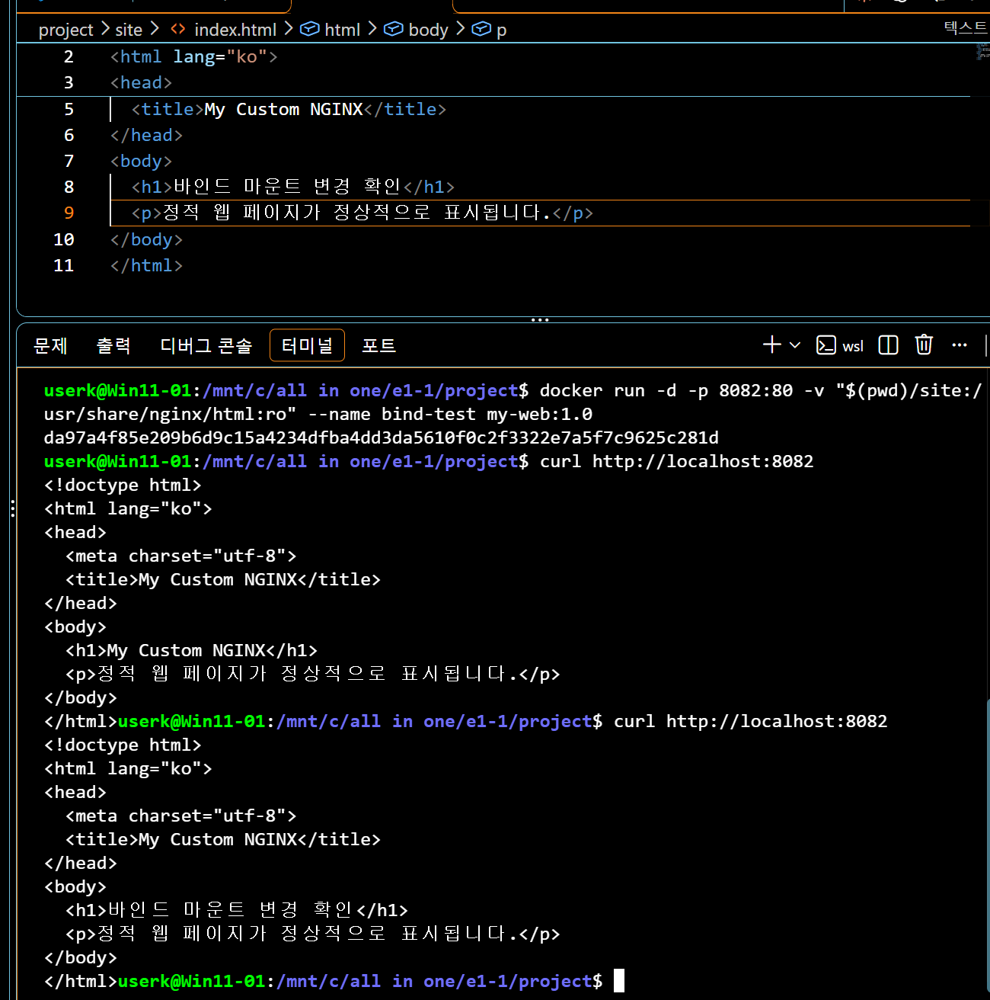
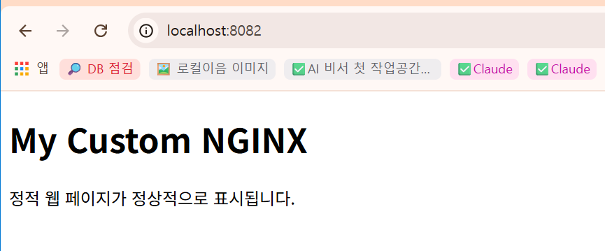
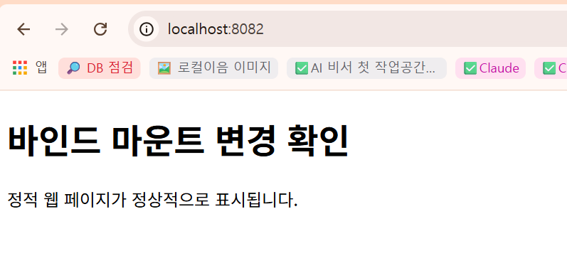

# project/site 바인드 마운트 확인

## 실행 위치

```text
/mnt/c/all in one/e1-1/project
```

## 컨테이너 실행

```bash
docker run -d -p 8082:80 -v "$(pwd)/site:/usr/share/nginx/html:ro" --name bind-test my-web:1.0
```

컨테이너가 생성되어 실행됐다.

```text
da97a4f85e209b6d9c15a4234dfba4dd3da5610f0c2f332e7a5f7c9625c281d
```

## 파일 수정 전 응답

첫 `curl http://localhost:8082` 응답에는 기존 제목 `My Custom NGINX`와 안내 문장이 표시됐다.

## 파일 수정 후 응답

VS Code에서 `project/site/index.html`의 `<h1>` 문구를 `바인드 마운트 변경 확인`으로 바꾸고 저장한 뒤, 다시 `curl http://localhost:8082`를 실행했다. 응답 HTML에 수정한 문구가 나타났다. 이는 호스트 파일 변경이 바인드 마운트를 통해 컨테이너의 NGINX 응답에 전달된 것을 확인한 결과다.



브라우저를 새로고침하기 전에는 기존 제목 `My Custom NGINX`가 보였다. `Ctrl+F5`로 새로고침한 뒤에는 `바인드 마운트 변경 확인` 문구가 표시됐다. 터미널과 브라우저 모두에서 호스트 파일의 변경이 반영된 것을 확인했다.




